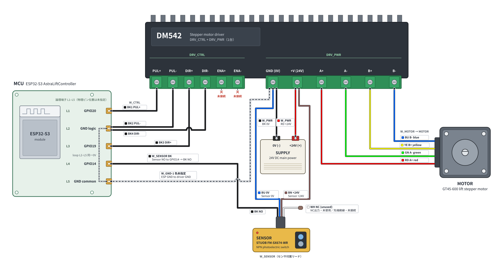
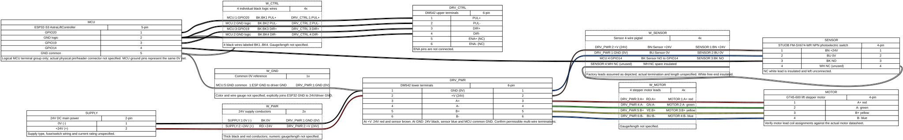

# 昇降機構の配線資料

GT45-600昇降機構（ESP32-S3 / AstraLiftController、DM542、FM-SX674-WR）の配線資料。
[2026-10-26のSlackスレッド](https://trail-weblab.slack.com/archives/C0C6W9H055M/p1792990590106589)の
添付4点を内容を変更せずに収録した。

| ファイル | 用途・出典 |
| --- | --- |
| [aha_lift_wireviz.yml](aha_lift_wireviz.yml) | 接続を記述するWireViz YAML。下記PDFからの転記。論理端子・配線色・未接続線・内部接続を含む |
| [aha_lift_wireviz.svg](aha_lift_wireviz.svg) | 添付されたWireViz出力。端子単位で接続を追うための図 |
| [aha_lift_layout.svg](aha_lift_layout.svg) | 添付された機器配置図。DM542の制御端子群・電源端子群を1台として表示 |
| [aharobot_lift_schematic.pdf](aharobot_lift_schematic.pdf) | 武田さんが共有した元資料。AHA-LIFT-SCH-001 REV 1.0、図面日付2026-10-25 |

YAMLと2つのSVGは[同スレッドの返信](https://trail-weblab.slack.com/archives/C0C6W9H055M/p1792999373635449)で共有されたもの。
接続の編集元はYAMLとし、WireViz出力と機器配置図も対応する内容に更新する。
PDFは転記元の記録として保持する。各添付のライセンス表記はない。

## 図の見方と確認範囲





- YAMLの端子番号と配置図のL1–L5は論理番号。ESP32基板の物理ピン位置やコネクタ型式を示さない。
  DM542の端子順・モーター線色も元資料の転記であり、実機とデータシートとの照合は別途必要。
- `MCU`の`loops`は論理端子2と5を同じ0Vとして扱う内部接続。
  `W_GND`はMCUとDM542電源側の共通GND線で、線色は未指定。
- DM542のENA+ / ENA-は未接続。センサ白線のNCは常閉接点の意味で、先端を絶縁して未接続としている。
  センサ黒線のNOをGPIO14へ接続する記述と区別する。
- YAMLとSVGは配線の資料で、USB接続、MCU内部プルアップ、原点復帰の速度・退避量など、
  元PDFの制御説明すべてを表すものではない。PDFの記述は現在のファームウェア仕様や動作保証を示さない。
- 実機との照合、通電・原点復帰試験はこの資料の取り込みでは実施していない。
  電源の供給元・保護回路、線径・長さ、コネクタ・圧着端子の型式、共締めの可否、
  ドライバ入力とMCU出力の電気的適合性は未確認。資料にない仕様を補完していない。

## WireViz出力の再生成

[WireVizの公式ドキュメント](https://github.com/wireviz/WireViz/blob/master/docs/README.md)を参照。
Python 3.11、uv、Graphviz（`dot`がPATH上にあること）が必要。
リポジトリ直下から、SVGのみを生成する。

```bash
uvx --python 3.11 --from wireviz==0.4.1 wireviz -f s docs/electrical/lift/aha_lift_wireviz.yml
```

添付SVGにはGraphviz 2.43.0の生成コメントがあるが、元のWireVizバージョンは記録されていない。
Graphvizやフォントの違いで配置は変わるため、再生成時は接続先・線色・未接続線・`loops`を照合する。
機器配置図はWireVizコマンドでは生成されない。更新後にYAMLとの対応と描画結果を確認する。
