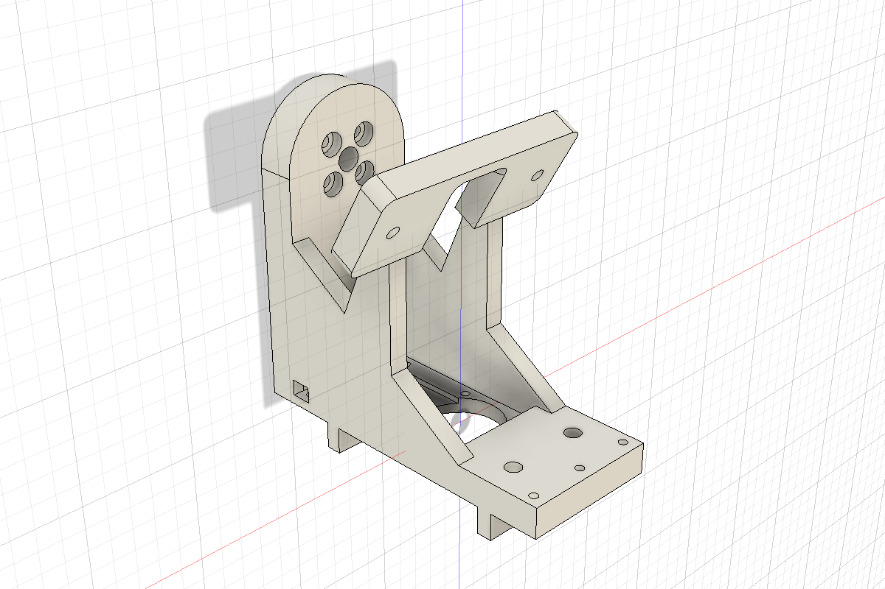
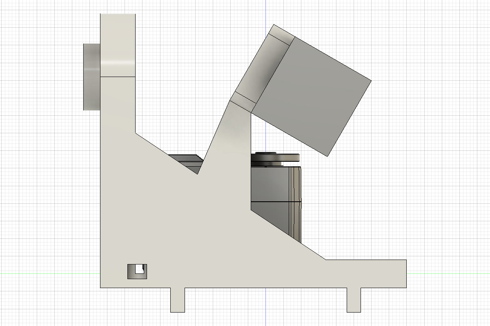

# wrist_cam_mount_d435i — 手首（グリッパ基部）の RealSense D435i 取付部品

> **ライセンス**: このディレクトリのファイルは上流 `Astra_Hardwares` の `Effector` からの派生物で、
> 上流と同じ **GPL-3.0 + 非商用** の条件が適用される。`aha_perception` パッケージの Apache-2.0 とは異なる
> （[出典一覧](../../../../../dependencies/THIRD_PARTY.md)）。

グリッパ基部（上流 `Effector`）のグリッパ用サーボの上に背板を一体で追加し、Intel RealSense D435i を
指の方向へ下向き 30° で取り付けられるようにした 3D プリント部品。カメラの前端はベース先端の面（Y = 40）より
10 mm 後ろにあり、つかむ物体とは干渉しない。

## 出典

- 元形状は上流 [`Effector.STL`](../../../../../upstream/Astra_Hardwares/Astra/STL/Effector.STL) の改変版
  `Effector_Modified`（Fusion アーカイブ `Effector(2).f3d`）。元のボディ（タイムライン 0〜18）は変更していない。
  新しい部品は元の STL の表面をすべて含む（trimesh で表面サンプル 20000 点を確認）。
- サーボ・指・レール・ネジの位置は上流 `Astra.STEP` の組立（`Link6^Astra:1`、`Link7L/R^Astra:1`）から求めた。

## ファイル

| ファイル | 内容 |
|---|---|
| `wrist_cam_mount_d435i.stl` | 印刷用 STL（mm、部品座標のまま）。そのまま +Z を上（レールの脚 Z = −11 をベッド側）にして印刷する。背板が本体の幅（±18）からはみ出すので、側面を下にした横置きはできない |
| `wrist_cam_mount_d435i.step` | 部品座標の STEP（mm、部品のボディのみ） |
| `wrist_cam_mount_d435i.f3d` | Fusion アーカイブ（ユーザーパラメータ・スケッチ・履歴付き）。確認用に `ST3215_gripper_dummy`（上流 `ST3215.step` の 8 ボディを組立位置に固定）と `D435_dummy`（D435i の外形 90 × 25 × 25.05 mm の箱。Fusion 内の名前は旧名のまま、背板のスケッチに連動）を含む |
| `preview_iso.png` | 部品単体 |
| `assembly_side.png` / `assembly_iso.png` | サーボと D435i の仮モデル付き。側面（+X から）と背面側 |
| `export_urdf_mesh.py` | URDF 用メッシュの生成と慣性の計算（`uv run export_urdf_mesh.py`）。[下記](#ロボットモデルurdfへの反映) |
| `urdf_wrist_check.png` | URDF の `link_l6`（D435i の箱を含む）・指と、光学フレームの軸（赤 x / 緑 y / 青 z） |
| [`aha_description/meshes/wrist_cam_mount_d435i_link6.stl`](../../../aha_description/meshes/wrist_cam_mount_d435i_link6.stl) | URDF 用メッシュ（D435i の箱を含む。`link_6` 座標、mm、URDF 側で scale 0.001） |

## 座標と周辺部品

部品座標（STL / STEP / f3d 共通、mm）。

- サーボホーン円盤: Y = −51.8 … −47、軸は Y 方向、中心 Z = 56（手首ロール軸）
- ベース板: Z = −4 … 4、先端面は Y = 40。リブ（X = ±13 … 18）は (Y, Z) = (17, 4) から (−37, 40) へ上がる
- グリッパのサーボ（ST3215）: ポケット内の x = ±12.4、Y = −35.1 … 10.1、Z = −3.2 … 34.6
- 先端の M2 × 3（x = 0, ±15、Y = 36.5）: ベース下面の MGN7C レール（Y = 33 … 40）を留める
- 指: ベース板の下（Z = −28 … −12）で +Y へ伸び、先端は Y = 130

## 追加した形状

- **背板**: 60 × 25 × 7（X = ±30）。前面（カメラ当たり面）は鉛直から前へ 30° 傾き、カメラの光軸は +Y から下へ 30°
  - カメラの前上端が Y = 30（`cam_front_y`、先端面から 10 mm 後ろ）に来る位置。カメラ外形は
    Y = −4.19 … 30、Z = 33.28 … 67.45
  - 背板の最下点（カメラ背面下端）は (Y, Z) = (−4.19, 45.8)（`cam_rear_z`）。サーボを前へ抜くために
    `servo_lift` だけ持ち上げたサーボの上端より 1 mm 上
- **支持フィン**: 左右 2 枚、X = ±(13 … 18)（リブと同じ位置、サーボの幅の外）。リブの上面（1.5 mm 重ねる）から
  背板の下面まで。前端は背板の最下点の真下（Y = −4.19）、後端は Y = −20（`fin_back_y`）
- **カメラネジ穴**: Ø3.4 × 2、ピッチ 45（X = ±22.5）、カメラ高さの中央（前面上の点 (2.06, 56.63)）。
  背板の後ろ上側から M3×10 で留める（かかり 10 − 7 = 3 mm）
- **ホーンネジ用の窓**: 背板の中央を Y 方向に切り抜いた窓。X = ±8.4（ネジ軸 ±4.9 + `win_margin` 3.5）、
  Z = 42.8 … 64.4（上端は上のネジ軸 60.9 + 3.5、下端は背板の最下点より下で、下側は開いている）、上の角 R3。
  カメラを外すと、縦板のホーンネジ M3 × 4 と中心穴に前からまっすぐ工具が入る
- **フィレット**: 背板の 4 隅（X = ±30）R3
- ベース上面とポケットの前は何も追加していない（先端の既存穴もそのまま）
- 外形: 60 × 91.8 × 85 mm（X = ±30、Y = −51.8 … 40、Z = −11 … 74）
- 体積: 63.99 cm³（元 53.03 cm³）。中実 PLA（1.24 g/cm³）で 79.4 g

### Fusion の履歴（追加分）

| # | フィーチャ | 内容 |
|---|---|---|
| 19–20 | `ST3215_gripper_dummy` / `st3215_bodies` | サーボの仮モデル（別コンポーネント、ベースフィーチャ） |
| 21 | `cam_plate_profile` | YZ 平面の背板断面スケッチ（完全拘束。先端面の縦エッジを投影して基準にする） |
| 22 | `cam_fin_profile` | YZ 平面のフィン断面スケッチ（完全拘束。背板の 2 点とリブ上面のエッジを投影） |
| 23–24 | `cam_fin_px` / `cam_fin_nx` | フィンを X = 13 … 18 と −13 … −18 に押し出し（結合） |
| 25 | `cam_plate` | 背板断面を `wall_w` で対称押し出し（結合） |
| 26–27 | `cam_holes` | 背板前面のスケッチと、M3 通し穴 2 個のカット |
| 28 | `cam_plate_corner_fillet` | 背板の 4 隅 R3 |
| 29–31 | `D435_dummy` / `d435_side` / `d435_body` | D435i の仮モデル（別コンポーネント。背板前面の線とカメラ背面下端の点を投影） |
| 32–33 | `horn_access_window` | XZ 平面の窓スケッチ（完全拘束）と、Y = −20 … 15 の範囲のカット |
| 34 | `horn_access_window_fillet` | 窓の上の角 R3 |

### Fusion ユーザーパラメータ

| 名前 | 値 | 内容 |
|---|---|---|
| `cam_tilt` | 30 deg | 光軸の下向き角度（+Y から）。背板前面の傾きと同じ |
| `cam_front_y` | 30 mm | カメラ前上端の Y（ベース先端面は Y = 40） |
| `screw_head_h` | 2 mm | ベース上面から出る M2 ネジ頭の高さ。先端の M2 × 3 はサーボを入れた後に締めるので、サーボを抜く前に外せば当たらない。2 mm は余裕として残している |
| `servo_top_z` | 34.6 mm | サーボ上端の Z（`Astra.STEP`） |
| `servo_lift` | 3.2 + 4 + `screw_head_h` + 1 mm（10.2 mm） | サーボを前へ抜くときの持ち上げ量（ホーン下端をベース上面とネジ頭の上へ） |
| `cam_rear_z` | `servo_top_z` + `servo_lift` + 1 mm（45.8 mm） | カメラ背面下端（背板の最下点）の Z |
| `fin_back_y` | −20 mm | 支持フィンの後端の Y |
| `wall_t` | 7 mm | 背板の厚さ |
| `wall_w` | 60 mm | 背板の幅 (X) |
| `cam_h` / `cam_d` / `cam_w` | 25 / 25.05 / 90 mm | D435i の高さ・奥行き・幅（`cam_w` は仮モデルのみ） |
| `cam_hole_pitch` | 45 mm | D435i 背面 M3 のピッチ |
| `cam_hole_d` | 3.4 mm | M3 の通し穴 |
| `horn_screw_x` / `horn_screw_z_hi` | 4.9 / 60.9 mm | ホーンネジの X 位置と上側の Z（窓の位置の基準） |
| `win_margin` | 3.5 mm | ホーンネジの軸から窓の縁までの余裕（M3 キャップボルトの頭 Ø5.5 が通る） |

`cam_tilt` を 20° / 40°、`screw_head_h` を 4 mm、`cam_front_y` を 40 mm、`fin_back_y` を −12 mm に変えても
再計算でエラーは出ず、D435i の仮モデルも追従する（確認済み）。

## サーボの出し入れ

部品とカメラはサーボの真上にかかるので、サーボは前から出し入れする。

1. 下からギアのネジを外してギアを外し、サーボのケーブルを抜く
2. カメラを外す（背板の M3 × 2）
3. サーボを `servo_lift`（10.2 mm）持ち上げ、前（+Y）へ抜く。入れるときは逆の順

## 確認したこと（Fusion / trimesh、モデル上）

- 組立状態: 部品・サーボ（8 ボディ）・D435i の仮モデルの重なり体積はすべて 0
- サーボの抜き差しの経路: サーボを 0 … 10.2 mm 持ち上げる途中と、持ち上げたまま前へ 0 … 87 mm 動かす途中
  （3 mm 刻み）で、部品と M2 ネジ頭（Ø3.8 × 高さ `screw_head_h` と仮定）との重なりは 0。
  持ち上げ量を 1.5 mm 多くしても背板に当たらない
- つかむ物体: カメラの前端は先端の面（Y = 40）より 10 mm 後ろ。部品も先端の面より前に出ない
- 手首の可動範囲（`Astra.STEP` の `Link3` / `Link4` の部品との距離、表面サンプルの最短距離。ピッチ軸 = X 方向、
  ヨー軸 = Z 方向で、どちらも (0, −75, 56) を通る）:
  - `link_r4`（`WristPitch` とピッチ用サーボ）: ピッチ ±90° で最小 3.3 mm（元の部品は 2.4 mm）
  - `link_r3`（`WristYaw`、ヨー用サーボ、2040 フレーム）: 指先を上（+Z 側）へ向けるピッチで、背板と D435i が当たる。
    1 mm 以上離れる最大ピッチは次のとおりで、元の部品より狭い

    | ヨー | 0° | ±30〜90° | ±120° | ±150° | 180° |
    |---|---|---|---|---|---|
    | この部品 | 67.5° | 65° | 47.5° | 35° | 32.5° |
    | 元の部品 | 90° | 90° | 87.5° | 67.5° | 55° |

    指先を下へ向けるピッチ（−90° まで）は 81 mm 以上離れている
- ホーンネジ（縦板の M3 × 4 と中心穴、+Y 側から締める）: カメラを外すと、5 本とも座ぐりから Y = 120 まで
  Ø5.5 の工具・ネジ頭の通り道が部品に当たらない（窓を通る）。カメラを付けたままでは、カメラ本体が
  通り道をふさぐ
- `win_margin` を 4 mm、`screw_head_h` を 4 mm に変えても窓は追従し、再計算でエラーは出ない
- 視野（レイキャスト、指を 50 mm 開いた状態）: 両方の指先が画面の下側に映る（RGB 視野の 18 %）。
  指先の間の 40 mm の立方体はカメラ前面から 76 … 110 mm、指先の 150 mm 先に置いた直径 66 mm の缶は
  140 … 258 mm で、画面中央の指先の間に映る。部品自体は視野に入らない
- 書き出し STL: 水密、1 ボディ、体積 63.995 cm³（Fusion 63.994 cm³）。STEP: ソリッド 1 個、体積 63.994 cm³

## ロボットモデル（URDF）への反映

両腕（`link_l6` / `link_r6`）に同じ部品と D435i を付けている。

- **メッシュ**: 上流の `link_r6.STL`（`link_l6.STL` と同一、33 ボディ）から、元の `Effector` と上流の旧カメラ
  （部品座標で x = ±19.5、Y = 10.9 … 42.9、Z = 4 … 49.1）を除き、この部品を足したものを
  `aha_description/meshes/wrist_cam_mount_d435i_link6.stl` に書き出す。レール・サーボ・ギア・ベアリング・ネジは
  上流のまま。上流の旧カメラと同じく D435i（90 × 25 × 25.05 mm の箱）も含め、カメラは `link_6` の一部として
  表示・衝突し、腕の点群モデルにも入る。`aha_description/scripts/patch_limits.py` がビルド時に両腕の visual / collision を差し替える
- 部品座標から `link_6` 座標（mm）への変換は (x, y, z) = (56 − Z, −X, Y + 75)。
  元の部品の表面の 98.8 % が上流の `link_r6.STL` から 0.5 mm 以内（中央値 0）にあることで確認した
- **慣性**: 上流の `link_6` の値（139.35 g）に、元の部品から増えた樹脂（中実 PLA、13.3 g）と D435i（72 g の箱、
  手首カメラの本体中心）を足した 224.65 g、重心 (0.0258, 0.0000, 0.0716) m。上流の値に旧カメラが含まれているかは
  不明で、差し引いていない（上流の重心は部品座標で Y = −11.9 とサーボ付近にあり、Y = 11 … 43 の旧カメラは
  含まれていないとみなした）。値は `export_urdf_mesh.py` の出力を `patch_limits.py` に転記している
- **カメラのフレーム**（`aha_description/urdf/sensors.xacro`）: `{left,right}_wrist_camera_link`（D435i の本体中心）と
  `{left,right}_wrist_camera_optical_frame`（RGB 光学中心）。実機・シミュレーションとも常に出す。
  本体の向きは x = 光軸、z = 部品の +Z 側（指と反対）を上とした。
  背面の下端 (Y, Z) = (−4.194, 45.8) が `link_6` の (10.2, 0, 70.806) mm、下向き 30° から、
  本体中心は `link_6` から (5.637, 0, 87.903) mm、ピッチ −60°。RGB 光学中心は (9.7, 32.5, 95.0) mm
- **シミュレーション**: Gazebo の手首カメラはこの光学中心に置く。光学特性と表示手順は
  [aha_perception](../../README.md#シミュレーション)、topic は [ROS インターフェース](../../../../../docs/interfaces.md#手首カメラ)を参照
- robot_state_publisher の TF が上の値と一致すること、D435i の箱が部品と重ならず背面が背板に接することを確認した
  （`urdf_wrist_check.png`）
- 部品を変えたら `export_urdf_mesh.py` を実行し、出力した慣性を `patch_limits.py` の `WRIST_PATCH` に転記する。
  上流の `link_6` の慣性は `astra_description.urdf` から、カメラの寸法・位置・傾きは `sensors.xacro` の
  `camera_body_*` / `wrist_camera_*` から読むため、カメラ位置が変わる場合は `sensors.xacro` だけ直して再実行する

## 未確認

- 実機での印刷・取り付けの記録は [カメラの検証記録](../../../../../docs/context/camera.md)。寸法・サポートの付き方は記録していない
- サーボのケーブルの向き・取り回し
- サーボがギアを外せば前へ抜ける組み方かどうか（上の手順は組立モデルからの想定）
- サーボとフィン・ポケット壁の隙間は左右 0.6 mm（元のポケットと同じ）
- D435i の USB-C ケーブル（カメラ +X 端面）の取り回し
- 実機のカメラの上下の向き。URDF はカメラの上面が部品の +Z 側（指と反対）を向くとしている。逆向きに付けた場合は
  `sensors.xacro` で光軸まわりに 180° 回す
