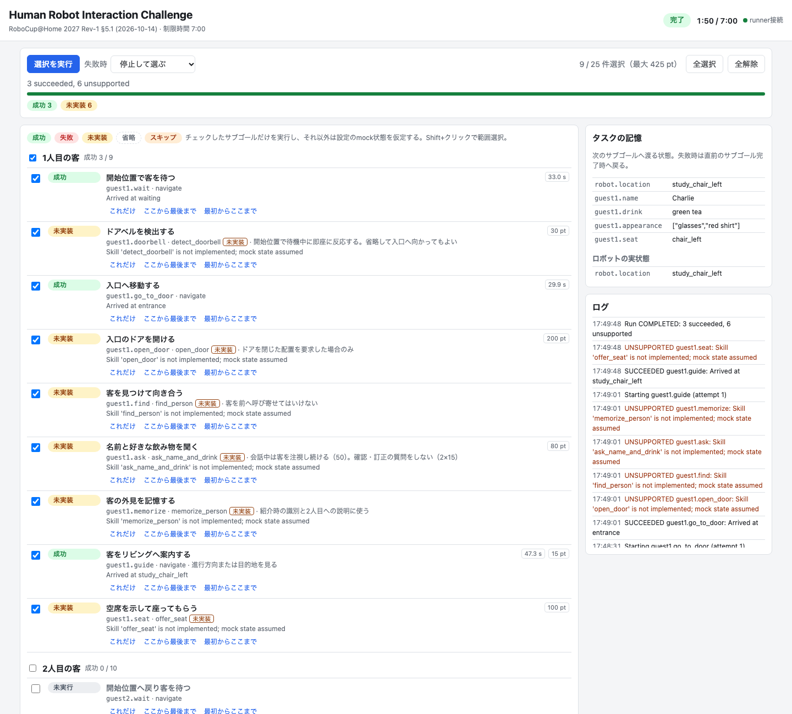

# aha_tasks

タスクをサブゴールに分けて実行・可視化する共通基盤と、RoboCup@Homeのタスク定義。

| 構成 | 内容 |
| --- | --- |
| `aha_tasks/core/` | ROS非依存の実行基盤。タスク定義の検証、サブゴールの選択、チェックポイント・ロールバック |
| `aha_tasks/skills.py` | 組み込みスキル `navigate` と `robot.location` の復元 |
| `aha_tasks/people.py` | 人の認識（[person_perception](../aha_perception/README.md#人の認識)）を使うスキル |
| `aha_tasks/gaze.py` | スキルの頭の向き先。人・Nav2の経路の先を追い続ける（[注視](#注視)） |
| `aha_tasks/gestures.py` | 右腕で席を指し示す `offer_seat`（[席の案内](#席の案内)） |
| `aha_tasks/seats.py` | 空いている席を探す `find_free_seat`（[空席の判定](#空席の判定)） |
| `aha_tasks/guests.py`、`sim_guests` | シミュレーションの客の動作（ROS非依存）と、Gazeboで客を動かすnode（[シミュレーションの客](#シミュレーションの客)） |
| `aha_tasks/teleport.py`、`sim_teleport` | デバッグ用。Nav2の代わりにGazeboでロボットを瞬間移動させる `NavigateToPose` のserver（[e2eの確認](#e2eの確認)） |
| `run_task` | runnerの準備を待って実行を始め、終了まで待って各サブゴールの所要時間を出すCLI（[e2eの確認](#e2eの確認)） |
| `aha_tasks/plan.py` | 計画の検証と、計画の手順を各スキルへ振り分ける `run_plan_step` |
| `aha_tasks/display.py`、`web/display/` | ロボットの画面の状態（ROS非依存）とROSの入出力、画面のページ（[ロボットの画面](#ロボットの画面)） |
| `aha_tasks/interaction.py` | スキルからの発話とタッチの質問、スキル `say` / `wait_start_signal` |
| `task_runner` | タスク定義を実行し、状態を配信・操作を受け付けるnode |
| `task_monitor` | 進捗表示・部分実行・失敗時の操作を行うWeb GUIと、ロボットの画面 |
| `config/<task>.json` | タスク定義 |
| `config/sim/<task>.json` | シミュレーションの客とドアの配置 |
| `launch/task.launch.py` | RCJO2026のGazebo、固定地図のNav2、runner、GUI、`head_look_at.py` を起動 |

ROSの入出力は [ROSインターフェース](../../../docs/interfaces.md#サブゴールタスクの実行)を参照。

## 起動

[開発コンテナ](../../../docs/docker.md)で実行する。別のsim / SLAMと同時に起動しない。

```bash
cd /app/overlay_ws
colcon build --symlink-install --packages-up-to aha_tasks
source install/setup.bash
ros2 launch aha_tasks task.launch.py task:=human_interaction
```

GUIは `http://localhost:8765/`（macOSは [`make forward`](../../../docs/docker.md#2-guiに接続する)）。
ロボットの画面は同じportの `/display/` で、GUIの右の欄にも同じ画面を表示する。
Nav2がACTIVEになると待機状態になり、GUIから実行する。runnerが終了するとlaunch全体が終了する（`e2e:=debug` を除く）。
ロボットの初期位置（Gazeboのspawn、AMCLの初期姿勢）はタスク定義の `initial_state` の `robot.location`。

| 引数 | 既定 | 内容 |
| --- | --- | --- |
| `task` | 必須 | `config/` のタスク名、またはJSONのパス |
| `e2e` | `final` | `final` はNav2とDGXのモデル、`debug` はシミュレーションの代替（[e2eの確認](#e2eの確認)） |
| `navigation` / `perception` | 空（`e2e` による） | `e2e:=debug` で代替を個別に戻す。`nav2` / `teleport`、`model` / `truth`。`final` は `nav2` / `model` だけ |
| `headless` | `false` | Gazebo GUIを起動しない |
| `gui_port` | `8765` | Web GUIのport |
| `people` | `false` | 頭部カメラのbridgeと[person_perception](../aha_perception/README.md#人の認識)（DGX Spark）を起動 |
| `ssh_host` / `ssh_port` / `ssh_user` | `10.99.0.1` / `2222` / 空 | `people:=true` のDGXの接続先 |
| `worker_command` | 空 | `people:=true` でDGXの代わりに起動するworkerのコマンド（[人の認識](../aha_perception/README.md#人の認識)） |
| `guests` | `false` | [シミュレーションの客](#シミュレーションの客)を動かす `sim_guests` を起動。`config/sim/<task>.json` が必要 |
| `people_scene` | 空 | [姿勢を付けた人](#姿勢を付けた人)を置く `sim_people` を起動。`config/sim/people/` の名前、またはJSONのパス |
| `subgoals` | 全て | 既定の選択 |
| `on_failure` | `pause` | 失敗時のポリシー |
| `max_retries` | `1` | ポリシー `retry` の再実行回数 |
| `startup_timeout` / `goal_timeout` | `300.0` / `600.0` | Nav2の起動待ちと各移動の上限（実時間の秒） |

## 実行の仕組み

- **部分実行**: 選択外のサブゴールは実行せず、スキルの期待状態と `mock` をタスクの記憶へ適用する。未実装のスキルも同様に通過する。
- **状態の同期**: スキルの実行前に、記憶上の `robot.location` と実際の位置が異なればNav2で移動する。
- **ロールバック**: 失敗するとタスクの記憶とロボットの位置をそのサブゴールの開始前へ戻す。人やドアなどは手で戻す（`guests:=true` の客とドアは戻したサブゴールに合わせて移動する）。
- **失敗時のポリシー**: `pause` は停止してGUIで再試行・巻き戻し・スキップ・中断を選ぶ。`retry` は `max_retries` 回まで再実行、`skip` は `mock` を仮定して続行、`abort` は終了する。

経過時間は制限時間と並べて表示するが、採点・時間切れの判定はしない。



## e2eの確認

シミュレーションのタスクの通しは、`e2e` で2つを使い分ける。

| | `e2e:=final`（既定） | `e2e:=debug` |
| --- | --- | --- |
| 移動 | Nav2（0.2 m/s） | `sim_teleport`：先にAMCLへ `/initialpose` を送り、AMCLのTFが目標の0.05 m・0.05 rad以内になった時点でGazeboの `set_pose` でロボットを移す。1.5 s後に成功。`guests:=true` では、移した後に客の歩く速さ（1.0 m/s）で直線距離を進む時間（1.5 s以上）待って成功する（ついて歩く客は、ロボットが移ってから歩き出す）。待ちは模擬時間で数え、`/clock` が10 s進まないときに失敗する |
| 人の認識（`people:=true`） | `person_perception.py` とDGXのSAM 3.1・VLM | [sim_person_detector.py](../aha_perception/README.md#シミュレーションの人の検出)：Gazeboの真の位置から、頭部カメラに見える客を出す。DGXを使わない |
| runnerの終了 | launch全体が終わる | runnerと人の認識のnodeは止めると2 s後に再起動し、Gazebo・AMCL・客はそのまま |

`perception:=model` を付けると、`debug` でも人の認識は `final` と同じになる（移動だけを省く）。
`people_scene` の人を探す・数えるには `perception:=model` が要る（`sim_person_detector.py` は `classify_person` を持たず、客だけを出す）。`people:=true` と `perception:=truth` に `people_scene` を付けると起動時にエラーにする。
`debug` で確かめられないため、`final` で確かめること：

- **移動**: 経路の有無（開かないドア、壁の向こうの地点）、Nav2の失敗・時間切れ、移動中のAMCLのずれ、移動中に見える人。`sim_teleport` は目標の、地図上のロボットの半径（0.40 m）に占有・未知のセルがないことだけを見る。AMCLのTFは2 s先の時刻で配信されるため、1回の移動に約4 sかかる。移した直後の1–2枚の画像は、前後の位置が混ざったTFで測られる。
- **人の認識**（`perception:=truth` のとき）: SAM 3.1の見落とし・誤検出・並んだ人の結合、マスクとDepthから求める位置、VLMの特徴・照合の誤り、DGXの往復の遅れ。人は高さ1.75 mの立った体の軸として扱い、名前は覚えたモデルに直ちに付く。
- **客の動き**: ロボットは待った後に一度に移るため、案内される客はロボットの経路をたどらず、壁を抜けて歩く。

```bash
# 1回目：起動して全体を実行（コンテナ内）
ros2 launch aha_tasks task.launch.py task:=human_interaction people:=true guests:=true e2e:=debug headless:=true
ros2 run aha_tasks run_task --on-failure skip --output /tmp/run.json  # 別のシェル

# 2回目以降：変えたnodeだけを止め（launchが再起動する）、対象のサブゴールだけを実行する
pkill -INT -f 'lib/aha_tasks/[t]ask_runner'  # スキル・タスク定義を変えた
pkill -INT -f '[p]erson_perception.py'       # perception:=model で認識を変えた（DGXのworkerも作り直す）
ros2 run aha_tasks run_task --subgoals 'introduce.*' --on-failure skip
```

HICの最初の `start.signal` は画面の `Start` のタッチを待つため、GUIの右の欄の画面で押すか、`--subgoals 'guest1.wait..'` で除く。
`run_task` はrunnerがReadyになるのを待って（再起動中なら次のrunnerを待って）始め、止まると各サブゴールの実時間（`robot.location` の復元を含む）、スキルごとの合計、全体の時間を出す。終了・失敗のほか、ポリシー `pause` で一時停止したとき（GUIで選ぶ）と、実行中にrunnerが再起動したときも止まる。完了のときだけ終了コード0。
`--output` は要約・最後の状態・ログをJSONに書く。`final` でも同じように使える（runnerの終了でlaunchが終わるため、毎回起動する）。
Pythonだけの変更は `--symlink-install` のビルドならそのまま反映される。ファイル・msgの追加ではビルドしてから止める。
`run_task` が `Runner not ready in time` で終わるときは、launchのログでrunnerの起動エラーを見る（タスク定義・スキルの誤りで起動前に終わると、状態を配信しないまま再起動を繰り返す）。
再起動したrunnerはロボットが `initial_state` の位置にいるとみなすため、最初に実行するサブゴールの記憶上の位置が初期位置なら、ロボットは移動しない。
人の認識のnodeは覚えた名前を実行をまたいで保つ。客を覚えるより前のサブゴールから走らせ直すときは、人の認識のnodeも止める（`pkill -INT -f '[s]im_person_detector.py'` か上の `person_perception.py`）。名前の付いた客は `find_person` の対象にならないため。

## タスク定義

[human_interaction.json](config/human_interaction.json) を参照。未知のキー・地点、不正な値は起動時にエラーになる。

| キー | 内容 |
| --- | --- |
| `task` / `title` / `rulebook` / `time_limit` | 識別子、表示名、ルールの出典、制限時間（秒） |
| `locations` | `map` frameの地点 `[x, y, yaw]`（m、rad）。障害物から0.6 m以上離す（壁や家具に寄せるとNav2が止まる） |
| `initial_state` | 開始時のタスクの記憶 |
| `skills` | スキル名と実装 `"module:Class"`。`null` は未実装 |
| `subgoals` | 実行順のサブゴール。`id`、`title`、`group`、`skill`、`params`、`mock`、`points`、`note` |

選択は `,` 区切りで、id（`guest1.ask`）、glob（`guest1.*`）、範囲（`guest1.find..guest1.seat`、片側省略可）を組み合わせる。
ROSなしで定義と選択を確認できる。

```bash
# リポジトリ直下
PYTHONPATH=overlay_ws/src/aha_tasks python3 overlay_ws/src/aha_tasks/scripts/task_runner \
  --config overlay_ws/src/aha_tasks/config/human_interaction.json --dry-run --subgoals 'guest2.*'
```

## スキルの追加

`aha_tasks.core.Skill` を継承し、タスク定義の `skills` に登録する。
インスタンスはスキル名ごとに1つで、`self.runtime` から `node`・`spec`・`navigation`・`gaze`（[注視](#注視)）・`skills`（名前からインスタンス。未実装は `None`）を使える。

```python
from aha_tasks.core import Skill, SkillResult


class AskNameAndDrink(Skill):
    @classmethod
    def validate(cls, params, spec):  # 起動時。不正ならValueError
        ...

    def ready(self):  # 依存するserverを待つ
        ...

    def execute(self, ctx):  # ctx.params / memory / cancelled / log
        guest = ctx.params["guest"]
        return SkillResult(True, "", {f"{guest}.name": name, f"{guest}.drink": drink})
```

成功時の `outputs` はタスクの記憶へ追加され、後続が `ctx.memory` から読む。
`expected(params)` は成功後とmock時に記憶へ追加する状態。ロボットを動かすスキルは `robot.location` を出力する。
実行しない場合の状態が記憶で変わるスキルは `assumed(params, memory)` を上書きする（既定は `expected(params)`）。
`execute` はタスク用threadで呼ばれる。`ctx.cancelled` を監視し、中断時は速やかに戻る。

## ロボットの画面

`task_monitor` が `/display/` でロボットのタッチディスプレイの画面を出す。
シミュレーションでは、GUIの右の欄の画面をクリックしてタッチの代わりにする。
文言は英語。ROSの入出力は [ROSインターフェース](../../../docs/interfaces.md#ロボットの画面)を参照。

| 表示 | 内容 |
| --- | --- |
| 字幕 | ロボットの発話の最新3件。最新を大きく表示する |
| 画像 | `/aha/display/image` の1枚（認識の結果など）。質問と同時なら横に並べる |
| 質問 | 文と1〜6個のボタン。タッチすると押したボタンを上部に表示する |
| 待機 | 何も出していなければ `AhaRobot` の文字 |

サーバーとの接続が切れると上部に `Not connected` を出し、ボタンを押せなくする。

スキルは `aha_tasks.interaction.Interaction.of(self.runtime)` から使う。

```python
interaction = Interaction.of(self.runtime)
ok, message = interaction.say("What is your name?", ctx.cancelled)
ok, message = interaction.show(
    jpeg_bytes, "jpeg", "I found the cup on the table.", ctx.cancelled
)
index, label = interaction.ask("Ready to start", ["Start"], ctx.cancelled)
```

- `say` は字幕を出し、TTS（`/aha/perception/audio/speak`）が起動していれば読み上げ終わるまで待つ（上限60 s）。TTSがなければ字幕だけで戻る（シミュレーション）。起動したばかりのrunnerはTTSをDDSで見つけるまで時間がかかるため、最初の1回だけ最大2 s待つ（`say` と `wait_start_signal` は `ready()` で待つ）。
- `show` は画像（JPEGかPNGのbytes）を出し、`say` で説明する。画像は次の画像か `hide()` まで残る。認識の結果は `show` で審判に示すだけで、タッチで答えを求めない。
- `ask` は画面にボタンを出し、タッチされると番号と文言を返す。タッチがなければ `index` が `None` で、`label` が理由（中断、`timeout` 秒の経過、置き換え、画面の終了）。`timeout` は実時間で、0以下は中断まで待つ。
- 画面に出る質問は1つで、新しい質問は表示中の質問を置き換え、前の質問はタッチなしで終わる。
- serverを見つけた直後に送ったgoalやその応答は失われることがある。`ask` は受け付けの応答が5 s以内になければ、serverが見えている間は質問を送り直す。送り直す前の質問がタッチされていれば、画面に出し直さずにそのタッチを返す。`say` は二重に読み上げないよう送り直さない。
- 画面の起動を5 s待っても `/aha/display/ask` がなければ、`ask` はタッチなしで終わる。待つ間も中断を受け付ける。
- `say` と `ask` は、待っている間にserver（TTS・`task_monitor`）が5 s続けて見えなくなると諦める。異常終了したプロセスがROSのグラフから消えるまで、DDSのリースの約20 sがかかる。

| スキル | 動作 | 使うサブゴール |
| --- | --- | --- |
| `say` | `text` を字幕に出し、TTSがあれば読み上げる | GPSRの `command.mode` |
| `wait_start_signal` | 準備ができたことと押すボタンを `text` で伝え、`button`（既定 `Start`）のタッチを待つ。どちらも省略できる | HICの `start.signal` |

TTSで読み上げられなかった場合も、`wait_start_signal` はボタンを出して待つ。
タッチを待つスキルは、HICの開始合図の `wait_start_signal` だけ。`show` を使うスキルはまだない。

`test/test_interaction.py` のROSのテストは `ROS_DOMAIN_ID=95`（`AHA_TEST_DOMAIN_ID` で変更可）で動かす。

## Human Robot Interaction Challenge

[ルールブック §5.1](https://robocupathome.github.io/RuleBook/rulebook/master.pdf)（2027 Rev-1、2026-10-14ドラフト）を30サブゴールに分ける。
`points` は得点表の最大点で、実行中に継続して求められる項目（注視など）はそのサブゴールに含める。
実装済みのスキルは `navigate`、[ロボットの画面](#ロボットの画面)を使う `wait_start_signal`、人の認識を使う `find_person` / `memorize_person` / `locate_guests` / `find_free_seat`（`people:=true` が必要）と、`offer_seat`。

ロボットは場内から始めるため、最初の `start.signal` で審判の手動の開始合図（§3.6.8）として画面の `Start` のタッチを待つ。
部分実行で `start.signal` を選ばなければ合図を待たない。

席の候補・ホスト・荷物置き場は固定の代替地点。ロボットは内側の `entrance` まで移動する。
`guests:=true` でなければ入口のドアは閉じたままで、人のモデルと追加の椅子は配置しない。荷物のモデルは配置しない。
地点は `/aha/tasks/locations` に配信し、RVizで表示できる。

```bash
rviz2 -d "$(ros2 pkg prefix --share aha_navigation)/rviz/nav.rviz" --ros-args -p use_sim_time:=true
```

### 人の認識を使うスキル

`/aha/perception/people` の人をスキル間でIDと名前で受け渡す。出力の `<役割>.position` は人の体の中心（`<役割>.frame` の座標）。
person_perceptionが起動していない場合は、実行時に失敗する（起動時の待機はしない）。発話は含まない。

| スキル | 動作 | 出力 |
| --- | --- | --- |
| `find_person` | 名前のない人のうち最も近い人を見て、`distance`（既定1.0 m）手前まで近づき向き合う。人が `map` 以外の座標なら見るだけ | `<role>.track` / `.position` / `.frame`、`robot.location` |
| `memorize_person` | `<guest>.track` の人（いなければ名前のない最も近い人）の外見を `guest` の名前で覚え、VLMで特徴を求める | `<guest>.appearance`（英語句のリスト）、`.track` / `.position` / `.frame` |
| `locate_guests` | 頭を正面・左・右へ `dwell`（既定10 s）ずつ向け、`guests` の全員を名前付きで見るまで待ち、最後に頭を正面へ戻す。名前はVLMが外見で照合して付けるため、席を入れ替えても区別する | 各客の `.track` / `.position` / `.frame` |

`find_person` と `memorize_person` は、終了後も頭をその人へ向け続ける（[注視](#注視)）。

待つ時間は `timeout`（`find_person` は30 s、`locate_guests` は60 s、`memorize_person` は10 s）、VLMは `describe_timeout`（180 s）で変更できる。`timeout` と `dwell` は模擬時間が有効ならノードの時計、それ以外はシステム時刻の補正に影響されない単調時計で数える。
模擬時間が実時間で10 s進まなければ、`/clock` の停止を理由に失敗する。
`locate_guests` は `map` 座標の観測だけを時点をまたいで蓄積する。他の座標では1つのメッセージ内で全員が見える必要がある。
同じtrack、または位置が0.4 m未満（`map` では水平距離）の客は重複とみなし、古い観測を捨てて探し続ける。
出力の `.track` は破棄済みのことがあるため、後続スキルは名前か位置を使って客を再取得する。
`memorize_person` をmockにした場合は外見を覚えないため、後の `locate_guests` はその客を見分けられない。

### シミュレーションの客

```bash
ros2 launch aha_tasks task.launch.py task:=human_interaction people:=true guests:=true ssh_user:=<Unixユーザー名>
```

`sim_guests` が `/aha/tasks/status` のサブゴールの状態と記憶に合わせ、[config/sim/human_interaction.json](config/sim/human_interaction.json) の配置で2人の客とドアをGazeboの中で動かし、座っているホストと追加の椅子を置く。
スキルには真値を渡さず、客の位置は頭部カメラと `person_perception` からだけ得る。
未実装のスキルがmockで一瞬で通過しても、状態から段階を決めるため客の動作は飛ばない。

| サブゴールの開始 | 客の動作 |
| --- | --- |
| 開始前 | 床下に隠れる。worldの壁は高さ0.8 mで、頭部カメラから壁の外の人が見えるため |
| `<guest>.doorbell` | 家の外からドアの外側へ歩き、中を向いて待つ |
| `<guest>.open_door` | ドアが外へ開く。以後は開いたまま |
| `<guest>.ask` | ドアの外側で左右に0.2 m（周期6 s）動き、ロボットを向く。ルールのとおり、会話が始まるまで家には入らない |
| `<guest>.guide` | ロボットとの距離を1.2 m保ち、ロボットが通った経路を歩いて家に入る |
| `<guest>.seat` | 記憶の `<guest>.seat`（`find_free_seat` が選んだ席）の前へ歩き、部屋を向いて立つ。記憶にない席なら客の設定の `seat` |

巻き戻しと、選択外で歩く間のない段階への移行は、歩かずに移動する。歩く速さ1.0 m/sはシミュレーション時刻。

`seats` の席ごとに、客が立つ位置 `pose`（席の0.45 m前）、座った人の位置 `sit`（座面の中央）と途中の点 `via` を書く。`chair` のある席には、worldにない椅子（`model://chair`）を置く（審判が椅子を追加する場面）。
`seated` の人（ホスト）は起動時から席に座る。モデルは `people_scene` と同じ座った人（`aha_tasks.sim_people`）で、`shirt` はその色の名前。ホストは `chair_left` にいるため、`find_free_seat` は1人目にホストの席を除いて `chair_right` を、2人目にさらに1人目の席を除いて `chair_extra` を選ぶ。各サブゴールの `mock` はこの席。

制限：

- 客は静止した立ち姿のモデル（`person_standing`）を動かすもので、脚は動かず、座らない（座った姿は別のモデルで、覚えた外見と変わるため）。シャツなどの色で2人を区別し、その他の外見は同じ。
- 客はvisualだけでcollisionがなく、ロボットを押さない。LiDARとカメラには写る。障害物は避けず、固定の経路と追従で歩く。
- 客の測定位置はロボットの自己位置の誤差の影響を受ける。
- ホストは座ったまま動かない（`bag.*` の追従はmock）。待っている他の客・荷物は含まない。

### 注視

runnerの `gaze`（`aha_tasks.gaze.Gaze`）が、スキルの頭の向き先を `/aha/perception/look_at` へ送る。
`task.launch.py` の `head_look_at.py` が頭を向け、`map` の点は台車が動いても向け直し続ける。
追う動作は次の指示まで続き、サブゴールをまたぐ。
タスクが一時停止・中断・終了すると追う動作をやめ、操作パネルやteleopで頭を動かせるようにする。再開後は、スキルが次に指示するまで最後の向き先を保つ。

| 指示 | 向き先 | 使うスキル |
| --- | --- | --- |
| `follow_person(people, track, name)` | 人の顔（`head` の0.1 m下。`head` はマスクの上端）。trackが消えたら名前で、それもなければ直前の位置から0.5 m以内の名前のない人を引き継ぐ。見失っている間は最後の点を保つ | `find_person`、`memorize_person`、`offer_seat` の後 |
| `follow_path(goal)` | Nav2の経路 `/plan` に沿って1.5 m先、高さ1.2 m。経路の終わりの先は経路の始点から終点への向き（進行方向）へ延ばし、始点と終点が0.3 m未満（その場で目標の向きへ回る）なら目標の向きへ延ばすため、到着時は正面を見る。新しい経路が届くまでは、目標地点から目標の向きへ1.5 m先（すでに目標にいて経路を待たずに終わっても、頭が真下や真横を向かない） | `navigate` と `robot.location` の復元（到着後は `hold`） |
| `look_at(frame, point)` / `look_towards(pan)` | 固定の点。追う動作をやめる | `locate_guests`、`find_free_seat`、`offer_seat` |
| `hold()` | 最後の向き先を保つ | `navigate` の到着後、タスクの停止時（runner） |

`find_person` で向けた客を、未実装の `ask_name_and_drink` の間も見続ける（ルールの「会話中に動く客を追う」）。
`navigate` の間は進行方向を見る（「進行方向または目的地を見る」）。
`navigate` と `robot.location` の復元はどのタスクでも頭を動かし、到着後は経路の先の点を `map` で保つ。到着後に机や床などを見るスキルは、`look_at` か `look_towards` で向き先を指示する。

### 空席の判定

`find_free_seat` は席の候補を順に頭で見て、人のいない最初の席を `<guest>.seat`（名前）と `<guest>.seat_position` に出力する。

```json
{"guest": "guest2", "seats": "living_room.seats", "radius": 0.8, "dwell": 1.5}
```

- **候補**: `seats` は座る場所ごとの `map` の点（座面の中央 `[x, y, z]`、m）のobjectか、それを入れた記憶のキー。並びが優先順。HICでは2人の客で同じ候補を使うため、`initial_state` の `living_room.seats` に書く。ソファは座る場所ごとに分ける。人の認識は家具を出さないため、地点と同じくセットアップ日に測って書く。審判が追加した椅子や、動かされた家具は反映されない。
- **占有**: `/aha/perception/people` の見えている人は、水平距離が `radius`（既定0.8 m）以内で最も近い席を占める。人の位置は体の見える面の中央で、席より手前に出る。席の前に立つ人も席をふさぐとみなす。探す間に見えた人をすべて数え、すでに埋まっている席は見ずに飛ばす。案内している客（`guest` の名前、`<guest>.track`）は数えない。ホストや先に座った客は、記憶ではなく見えた人として除く（着席後に席を入れ替えることがあるため）。
- **見た判定**: 頭を席の0.4 m上（座った人の胴）へ向け、2 s（頭の旋回）後に届いたメッセージの次のメッセージで、その席を見たとする。2 s + `dwell`（既定1.5 s）の間に誰もいなければ空席として終わり、頭は席を向いたままにする。待ち時間は他の人の認識のスキルと同じ時計で数える。
- **見ない席**: `robot.location` の向きから左右90°（頭のpanの範囲）を超える席は見ない（台車は回さない）。案内先は席が前に来る位置にする。
- **空席が見えないとき**: 埋まっていると見えなかった最初の席（見えなかった席、見ない席を含む）を出力し、席ごとの理由（`chair_left: person 3 sits there`、`not seen`、`not looked at` など）をメッセージに付ける。人の認識が止まっているか `map` 以外の座標なら、残りの席は見ない。失敗するのは全席が埋まっていると見えたときだけ（以後は失敗時のポリシーに従い、`skip` なら `mock` の席で続ける）。

制限：

- 案内中に客のtrackが切れ、名前のない新しいtrackになると、客は占有者として数えられる。客が席の近くに立っていればその席を飛ばし、別の席を示す。

### 席の案内

`offer_seat` は席の点（`map` の `[x, y, z]`）を頭で見て、右腕で指し示す。席は記憶の `<guest>.seat` と `<guest>.seat_position`（`find_free_seat` の出力）で、paramsに `seat` と `position` を与えるとそれを使う。記憶にもparamsにもなければ、動かずに失敗する。

```json
{"guest": "guest1", "height": 0.8, "hold": 3.0}
```

1. 席が右腕で指せる方向（肩から見て右100°〜左60°）になければ、Nav2でその場で席へ向く。
2. `lift_controller` があれば手首を床から `height` m（既定0.8 m）へ上げ、腕を席へ伸ばす。手先のx軸が席の点を通る関節値を [aha_manipulation.pointing](../aha_manipulation/aha_manipulation/pointing.py) が求める。
3. 腕が着いたら現在のTFで関節値を求め直し、移動直後に台車がずれていれば向け直す。`hold` 秒（既定3 s、模擬時間）保ち、腕と昇降を開始時の姿勢へ戻す。頭は客（`<guest>.track`、名前）を追う。指し示す途中で失敗・キャンセル・例外（controllerやTFの時間切れ）があっても、腕と昇降を開始時の姿勢へ戻してから失敗を返す。

出力は `<guest>.seat`（席の名前）。`robot.holding` があるとき（`guest2` は荷物を持つ）は腕を動かさず、頭だけで席を示す。
腕は `right_arm_controller` / `lift_controller` へ関節空間の直線の軌道を送り、衝突は確認しない。開始時の姿勢から指す姿勢までの間に障害物がないことが前提で、シミュレーションの初期姿勢（全関節0）からの動作だけを確認している。

## Pick and Place Challenge

[ルールブック §5.2](https://robocupathome.github.io/RuleBook/rulebook/master.pdf)（2027 Rev-1、2026-10-14ドラフト）を71サブゴールに分ける。
実装済みのスキルは `navigate` のみで、他はmockで通過する。

```bash
ros2 launch aha_tasks task.launch.py task:=pick_and_place subgoals:='dishwasher.*'
```

既定の順序は、ゴミ、食洗機（扉の開閉は1回）、棚、朝食、補助台。物体は1個ずつ運ぶ。
`points` は得点表の最大点で、合計は総計の3515。負の項目は `note` に書く。
得点表の認識・取得・配置は12個分で物体は14個あるため、補助台の2個を枠の外として0 ptにする（`note` に数える場合の点を書く）。
First Pick Bonusは既定の順序で最初に取る `trash.table.pick` に載せる。

| 地点 | 使い方 | sim上の場所 |
| --- | --- | --- |
| `dining_table` | 食卓 | `dining_table` の+y側 |
| `dishwasher` | 食洗機 | worldにないため、食卓の近くの壁（`inside_wall_center_vertical_front`）の前に置いた代替地点 |
| `trash_box` | ゴミ箱と床のゴミ | `trash_box` の−x側 |
| `shelf` | 棚 | `shelf` の−y側 |
| `tall_table` | ボウル・スプーン・洗剤タブの指定の台 | `tall_table` の−y側 |
| `long_table` | 補助台 | `long_table` の−y側 |

入口のドアは閉じたままで、ロボットは内側の `spawn` から始める。物体のモデルは配置しない。

### 記憶の受け渡し

`perceive_objects` は `<output>.<役割>` に物体を出力し、`pick_object` / `place_object` の `object` はそのキーを指す。
把持中の物体は `robot.holding` に持ち、置くと `null` になる。

| サブゴール | 出力 |
| --- | --- |
| `table.perceive` | `table.cutlery` / `.cup` / `.plate` / `.trash` / `.other1` / `.other2` |
| `trash.floor.perceive` | `trash.floor` |
| `tab.perceive` | `dishwasher.tab` |
| `cabinet.perceive` | `cabinet.categories`（段ごとのカテゴリ） |
| `breakfast.perceive_tableware` / `.perceive_food` | `breakfast.bowl` / `.spoon` / `.cereal` / `.milk` |
| `extra.perceive` | `extra.obj1` / `.obj2` |

ゴミのカテゴリはセットアップ日に発表されるため、`initial_state` の `ppc.trash_category` に設定する。
タスク固有のスキルのparamsは `perceive_shelf`（`surface`、`objects`、`output`）、`open_container`（`object`）、`pour`（`object`、`target`）。

## General Purpose Service Robot Challenge

[ルールブック §5.3](https://robocupathome.github.io/RuleBook/rulebook/master.pdf)（2027 Rev-1、2026-10-14ドラフト）を29サブゴールに分ける。
3命令をまとめて受け取り、`plan.generate` が記憶へ出力した計画を `exec.step01`〜`exec.step20` で1手順ずつ実行する。
実行の枠は命令に結びつかないため、命令の解決（3×250）とInterleaved Task Bonus（200）の950点は `finish.report` に計上する。
実装済みのスキルは `navigate`、`run_plan_step`、`say`（[ロボットの画面](#ロボットの画面)）、人の認識を使う `find_described_person` / `count_people`（`people:=true` が必要）。`plan_commands` と `listen_command` はmockの命令3件とその計画で通過する。

### 計画

```json
{"command": 1, "action": "pick_object", "params": {"object": "cola", "surface": "kitchen_table"}, "mock": {"robot.holding": "cola"}}
```

`command` は1〜3、`action` は `skills` のスキル名。`mock` は省略できる。
`run_plan_step`（params `{"index": i}`）は、計画の `i` 番目の手順を同名のスキルへ振り分ける。

- **検証**: `validate_plan(plan, spec)` はROSなしで呼べる。不正な形、枠の数を超える長さ、未宣言の `action`、タスクの流れ用の `action`（`run_plan_step` など）、`locations` にない `location` と `mock` の `robot.location`、実装済みスキルの `validate` に通らないparamsを拒否する。`mock` の計画は起動時に、記憶の計画は枠の実行ごとに全手順を検証する。不正なら最初の枠で移動前に失敗する。
- **手順がない枠**: 即座に成功する。記憶に計画がなければ失敗する。
- **未実装のスキル**: 成功として通過し、手順の `mock` を記憶へ追加する。メッセージに未実装と出る。`mock` の `robot.location` にはNav2で移動する。
- **実装済みのスキル**: `execute` の `outputs` と `expected(params)` が `run_plan_step` の出力として記憶へ入る。失敗はそのサブゴールの失敗として扱われ、ロールバック・再試行が手順単位で働く。
- **選択外・スキップ**: 枠を実行しない場合は、手順の `expected(params)` と `mock` を記憶へ追加する。`exec.step05` だけを選ぶと、手前の手順の `robot.location` へNav2で移動してから実行する。到達できない地点へ移動する手順をスキップすると、次に実行する枠はその地点への移動で失敗する。

| 手順 | params | 生成器の命令 |
| --- | --- | --- |
| `navigate` | `location` | goToLoc |
| `find_object` | `object`、`location` | findObjInRoom、findObj |
| `pick_object` / `place_object` | `object`、`surface` | takeObjFromPlcmt、takeObj、bringMeObjFromPlcmt / placeObjOnPlcmt、putObjInTrash（`surface: trashbin`） |
| `deliver_object` | `object`、`person`（`operator` は命令した人） | bringMeObjFromPlcmt、deliverObjTo* |
| `find_described_person` | `gesture` / `pose` / `clothing` / `description` / `name`、`location` | findPrsInRoom、meetPrsAtBeac、greet*、talkInfoToGestPrsInRoom、tellPrsInfo* |
| `say` / `answer_question` | `text` / `question` | 挨拶 / talkInfo、talkInfoToGestPrsInRoom |
| `count` | `target`、`location`、`output` | countObjOnPlcmt |
| `count_people` | `output`、`gesture` / `pose` / `clothing` / `description`（省略で全員）、`location` | countPrsInRoom、countClothPrsInRoom |
| `describe` | `target`、`location`、`output` | tellObjPropOnPlcmt、tellCatPropOnPlcmt、tellPrsInfo* |
| `tell_info` | `key`（記憶のキー）、`person` | `count` / `describe` の結果を伝える |
| `follow_person` / `guide_person` | `person`、`location`（`follow_person` は省略可） | follow* / guide* |

`find_described_person` は名前・ジェスチャ・姿勢・服で探す。HICの `find_person`（名前のない最も近い人）とは別のスキル。

### 人を探す・数えるスキル

人の条件は、[コマンド生成器](https://github.com/RoboCupAtHome/CommandGenerator)の句をそのまま渡す（`"waving person"`、`"person raising their left arm"`、`"persons pointing to the right"`、`"sitting person"`、`"person wearing a red t shirt"`、`"people wearing gray sweaters"`）。値だけ（`"waving"`、`"sitting"`、`"red t shirt"`）も受け付ける。
`gesture` / `pose` / `clothing` / `description` は組み合わせられ、矛盾する指定は検証で拒否する。左右は本人の左右。
句の解釈は [person_description.py](aha_tasks/person_description.py)、人の判定は [person_perception](../aha_perception/README.md#姿勢ジェスチャ服) の `ClassifyPerson`。

- **範囲**: `location` の地点（省略時はロボットの位置）から `radius`（既定3.0 m）以内の人だけを対象にする。人が `map` 以外の座標なら範囲で絞らない。部屋の形は使わない。
- **見回し**: 頭を `pans`（既定 `[0.0, 0.4, -0.4]` rad）へ `dwell`（既定6 s）ずつ、2 m先の高さ `look_height`（既定1.0 m）へ向ける。
- **判定**: 1人につき、頭をその人の頭へ向けて0.75 s待ち、その時に見えた頭の位置へ向け直してさらに0.75 s待つ（頭が画像の端で切れると頭の位置が低く出るため。挙げた手も写るように）。次に `skip_vlm` で深度とキーポイントの確かな答えだけを聞く。条件の成否が決まらなければ（服、不確かな姿勢・ジェスチャ）VLMに聞く。VLMの答えは `describe_timeout`（既定180 s、person_perceptionの `vlm_timeout` に合わせる）より30 s長く待つ（サーバーは先に動きを待つため）。判定に失敗した人（見失った、VLMの失敗、時間切れ）はもう1回判定し、それでも失敗すれば「判定できず」として続ける。中断は `Cancelled` で返す。
- **名前**: `name` は person_perceptionが覚えた名前とだけ照合する。名前がまだ付いていない人（新しいtrackには数秒後に付く）は、付くのを待つ。名前を尋ねる会話は含まない。
- **制限時間**: `timeout` に達すると、1人の判定（注視と `ClassifyPerson` の待ち）の途中でも打ち切る。

| スキル | 動作 | 出力 |
| --- | --- | --- |
| `find_described_person` | 見回しながら、範囲内の人を近い順に1回ずつ判定し、最初に条件に合った人を見て、`approach`（既定 `true`）なら `distance`（既定1.0 m）手前まで近づく。`timeout`（既定60 s）で失敗 | `<role>.track` / `.position` / `.frame`、見えた `<role>.pose` / `.gesture` / `.garments`、`robot.location`（`role` の既定は `person`） |
| `count_people` | `pans` を1巡し、見えている人を1人ずつ判定する。その向きに判定していない人が残る間は次の向きへ進まず、人を判定したらその向きを `dwell` だけ見直す。1人の判定は1回（失敗した場合は2回まで）で、判定できなかった人と、答えで条件の成否が決まらなかった人は数えない。`map` で0.5 m未満の観測は同じ人とする。`timeout`（既定300 s）で失敗 | `<output>`（人数）、`<output>.positions`（条件に合った人の最後の位置） |

trackは視野を外れると3 sで破棄され、見直すと別のIDになる。そのため判定は見えている間に行い、判定した人の `map` の位置から0.5 m未満に現れた新しいtrackは、同じ人として判定し直さない（数え直さない）。ただし、判定した人のtrackが同じ画像にまだ見えていれば、近くの新しいtrackは別の人として判定する。

### 姿勢を付けた人

`people_scene:=<名前>` は [config/sim/people/](config/sim/people/) の配置で、姿勢やジェスチャを付けた人をGazeboに置く（`sim_people`）。人はタスクの間、同じ場所で同じ姿勢を保つ。スキルには配置を渡さない。

```bash
ros2 launch aha_tasks task.launch.py task:=gpsr people:=true people_scene:=gpsr ssh_user:=<Unixユーザー名>
```

| 配置 | 内容 |
| --- | --- |
| `gpsr` | GPSRのmockの計画用。寝室に左腕を挙げた人と立つ人、オフィスに手を振る人・椅子に座る人・左を指す人 |
| `attributes` | 人の認識の確認用。寝室・オフィス・リビングに、9種類の姿勢・ジェスチャとシャツの色が異なる10人（[person_attributes_report.py](../aha_perception/README.md#姿勢ジェスチャ服) の `--truth` に使う） |

人ごとに `label`（`standing` / `sitting` / `lying` / `waving` / `raising_left_arm` / `raising_right_arm` / `raising_both_arms` / `pointing_left` / `pointing_right`）、`shirt`（`purple` / `red` / `blue` / `yellow` / `orange` / `green` / `white` / `gray` / `black`）、`position`（m。立つ・座る人は足元、寝る人は体の中央。`z` は足の裏または寝た背中の高さ）、`yaw`（体の正面の向き）を書く。

- モデルはGazebo Fuelの [Male visitor](https://app.gazebosim.org/OpenRobotics/fuel/models/Male%20visitor)（version 2、CC0）。初回に取得してハッシュを確かめ、骨格の重みで姿勢を付けたメッシュとシャツの色を変えたテクスチャを `~/.cache/aharobot/sim_people` に作る。
- 手を振る人は、前腕を左右に25°傾けた2つのメッシュを `wave_period`（模擬時間の秒）で交互に見せる。
- 座る人は脚を椅子の座面の高さに合わせた形で、`z` 0の椅子の位置に置く。寝る人は仰向けで、頭が体の向きの後ろ（yaw 0なら−x）になる。`attributes` の寝る人は、頭が枕に埋もれないよう足をベッドの枕側へ向けている。
- 体型は1種類（男性）で、服は半袖のTシャツと半ズボンだけ。シャツ以外の服の種類はsimでは確かめられない。
- visualだけでcollisionがなく、ロボットを押さない。LiDARとカメラには写る。
- Gazeboを動かしたまま `sim_people` を起動し直すと、同じ名前で残っている人は作り直さず位置だけ合わせる。作れない人がいても他の人は続ける。

### 地点

部屋・家具のラベルは[CompetitionTemplate](https://github.com/RoboCupAtHome/CompetitionTemplate)の語彙を `_` 区切りにしたもので、RCJO2026 simの部屋・家具を割り当てる。simにない語彙は登録しない。

| 部屋 | simの部屋 | 家具（simのモデル） |
| --- | --- | --- |
| `bedroom` | Bed Room | `bed` |
| `kitchen` | Dining Room | `kitchen_table`（`dining_table`）、`sofa`（`couch_right`） |
| `office` | Study Room | `chairs`（`chair_left` / `chair_right`）、`shelf` |
| `living_room` | Living Room / Laundry Area | `desk`（`long_table`）、`side_tables`（`tall_table`）、`trashbin`（`trash_box`） |

`instruction_point` は固定の代替地点で、発表された地点に合わせて座標を変える。入口のドアは閉じたままで、ロボットは内側の `spawn` から始める。
審判がタイマーを止める間も、GUIの経過時間は止まらない。

## Doing Laundry Challenge

[ルールブック §5.4](https://robocupathome.github.io/RuleBook/rulebook/master.pdf)（2027 Rev-1、2026-10-14ドラフト）を41サブゴールに分ける。
`points` は得点表の最大点で、合計は総計の4415。減点は `note` に書く。
実装済みのスキルは `navigate` のみで、洗濯機と衣類の操作はmockで通過する。

| 地点 | 位置 |
| --- | --- |
| `washing_machine` | worldの洗濯機の前 |
| `laundry_basket` | worldのバスケットの前 |
| `folding_table` | 畳む台の固定の代替地点。worldの `long_table` の前 |

入口のドアは閉じたままで、ロボットは内側の `spawn` から始める。
worldの `pile_of_clothes` と `laundry_in_drum` は剛体で、畳める衣類のモデルはない。

順序は、洗濯機の扉を開ける、1枚をバスケットへ移す、バスケットを台の横へ運ぶ（`basket.carry` は持つ・移動・置くを1スキルにまとめる）、台の1枚を畳む（`shirt0.*`）、バスケットの衣類を取って畳み重ねる（`shirt1.*`〜`shirt6.*`）。
台への `navigate` は `shirt0.*` と `shirt1.*` の先頭のみ。`shirt2.*` 以降は記憶上の位置が台なので、実装済みのスキルを実行する前に移動する（状態の同期）。
`shirt0.*` は0点で、`shirt0.state` のみを変える。台が空の配置では選択から外しても後続の記憶は変わらない。

洗濯機とバスケットを飛ばす場合は `start.*,shirt1.*` を選ぶ。バスケットは記憶上台の横にあるため、実物は手で置く。

| 記憶 | 内容 |
| --- | --- |
| `robot.holding` | 持っている衣類（`washer_shirt`、`shirtN`）。置くと `null` |
| `basket.location` | バスケットのある地点。`laundry_basket`、運ぶと `folding_table` |
| `table.stack` | 重ねた枚数。`shirtN.stack` で `N` |
| `shirtN.state` | `placed`、`spread`、`folded`、`stacked` |
