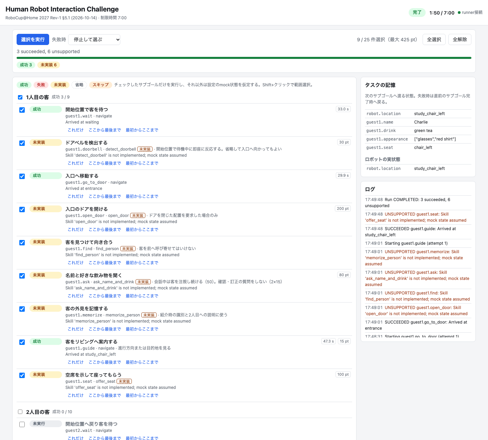

# aha_tasks

タスクをサブゴールに分けて実行・可視化する共通基盤と、RoboCup@Homeのタスク定義。

| 構成 | 内容 |
| --- | --- |
| `aha_tasks/core/` | ROS非依存の実行基盤。タスク定義の検証、サブゴールの選択、チェックポイント・ロールバック |
| `aha_tasks/skills.py` | 組み込みスキル `navigate` と `robot.location` の復元 |
| `aha_tasks/people.py` | 人の認識（[person_perception](../aha_perception/README.md#人の認識)）を使うスキル |
| `aha_tasks/gaze.py` | スキルの頭の向き先。人・Nav2の経路の先を追い続ける（[注視](#注視)） |
| `aha_tasks/gestures.py` | 右腕で席を指し示す `offer_seat`（[席の案内](#席の案内)） |
| `aha_tasks/guests.py`、`sim_guests` | シミュレーションの客の動作（ROS非依存）と、Gazeboで客を動かすnode（[シミュレーションの客](#シミュレーションの客)） |
| `aha_tasks/plan.py` | 計画の検証と、計画の手順を各スキルへ振り分ける `run_plan_step` |
| `task_runner` | タスク定義を実行し、状態を配信・操作を受け付けるnode |
| `task_monitor` | 進捗表示・部分実行・失敗時の操作を行うWeb GUI |
| `config/<task>.json` | タスク定義 |
| `config/sim/<task>.json` | シミュレーションの客とドアの配置 |
| `launch/task.launch.py` | RCJO2026のGazebo、固定地図のNav2、runner、GUI、`head_look_at.py` を起動 |

ROSの入出力は [ROSインターフェース](../../../docs/interfaces.md#サブゴールタスクの実行)を参照。

## 起動

[開発コンテナ](../../../docs/docker.md)で実行する。別のsim / SLAMと同時に起動しない。

```bash
cd /app/overlay_ws
colcon build --symlink-install --packages-up-to aha_tasks
source install/setup.bash
ros2 launch aha_tasks task.launch.py task:=human_interaction
```

GUIは `http://localhost:8765/`（macOSは [`make forward`](../../../docs/docker.md#2-guiに接続する)）。
Nav2がACTIVEになると待機状態になり、GUIから実行する。runnerが終了するとlaunch全体が終了する。
ロボットの初期位置（Gazeboのspawn、AMCLの初期姿勢）はタスク定義の `initial_state` の `robot.location`。

| 引数 | 既定 | 内容 |
| --- | --- | --- |
| `task` | 必須 | `config/` のタスク名、またはJSONのパス |
| `headless` | `false` | Gazebo GUIを起動しない |
| `gui_port` | `8765` | Web GUIのport |
| `people` | `false` | 頭部カメラのbridgeと[person_perception](../aha_perception/README.md#人の認識)（DGX Spark）を起動 |
| `ssh_host` / `ssh_port` / `ssh_user` | `10.99.0.1` / `2222` / 空 | `people:=true` のDGXの接続先 |
| `worker_command` | 空 | `people:=true` でDGXの代わりに起動するworkerのコマンド（[人の認識](../aha_perception/README.md#人の認識)） |
| `guests` | `false` | [シミュレーションの客](#シミュレーションの客)を動かす `sim_guests` を起動。`config/sim/<task>.json` が必要 |
| `subgoals` | 全て | 既定の選択 |
| `on_failure` | `pause` | 失敗時のポリシー |
| `max_retries` | `1` | ポリシー `retry` の再実行回数 |
| `startup_timeout` / `goal_timeout` | `300.0` / `600.0` | Nav2の起動待ちと各移動の上限（実時間の秒） |

## 実行の仕組み

- **部分実行**: 選択外のサブゴールは実行せず、スキルの期待状態と `mock` をタスクの記憶へ適用する。未実装のスキルも同様に通過する。
- **状態の同期**: スキルの実行前に、記憶上の `robot.location` と実際の位置が異なればNav2で移動する。
- **ロールバック**: 失敗するとタスクの記憶とロボットの位置をそのサブゴールの開始前へ戻す。人やドアなどは手で戻す（`guests:=true` の客とドアは戻したサブゴールに合わせて移動する）。
- **失敗時のポリシー**: `pause` は停止してGUIで再試行・巻き戻し・スキップ・中断を選ぶ。`retry` は `max_retries` 回まで再実行、`skip` は `mock` を仮定して続行、`abort` は終了する。

経過時間は制限時間と並べて表示するが、採点・時間切れの判定はしない。



## タスク定義

[human_interaction.json](config/human_interaction.json) を参照。未知のキー・地点、不正な値は起動時にエラーになる。

| キー | 内容 |
| --- | --- |
| `task` / `title` / `rulebook` / `time_limit` | 識別子、表示名、ルールの出典、制限時間（秒） |
| `locations` | `map` frameの地点 `[x, y, yaw]`（m、rad）。障害物から0.6 m以上離す（壁や家具に寄せるとNav2が止まる） |
| `initial_state` | 開始時のタスクの記憶 |
| `skills` | スキル名と実装 `"module:Class"`。`null` は未実装 |
| `subgoals` | 実行順のサブゴール。`id`、`title`、`group`、`skill`、`params`、`mock`、`points`、`note` |

選択は `,` 区切りで、id（`guest1.ask`）、glob（`guest1.*`）、範囲（`guest1.find..guest1.seat`、片側省略可）を組み合わせる。
ROSなしで定義と選択を確認できる。

```bash
# リポジトリ直下
PYTHONPATH=overlay_ws/src/aha_tasks python3 overlay_ws/src/aha_tasks/scripts/task_runner \
  --config overlay_ws/src/aha_tasks/config/human_interaction.json --dry-run --subgoals 'guest2.*'
```

## スキルの追加

`aha_tasks.core.Skill` を継承し、タスク定義の `skills` に登録する。
インスタンスはスキル名ごとに1つで、`self.runtime` から `node`・`spec`・`navigation`・`gaze`（[注視](#注視)）・`skills`（名前からインスタンス。未実装は `None`）を使える。

```python
from aha_tasks.core import Skill, SkillResult


class AskNameAndDrink(Skill):
    @classmethod
    def validate(cls, params, spec):  # 起動時。不正ならValueError
        ...

    def ready(self):  # 依存するserverを待つ
        ...

    def execute(self, ctx):  # ctx.params / memory / cancelled / log
        guest = ctx.params["guest"]
        return SkillResult(True, "", {f"{guest}.name": name, f"{guest}.drink": drink})
```

成功時の `outputs` はタスクの記憶へ追加され、後続が `ctx.memory` から読む。
`expected(params)` は成功後とmock時に記憶へ追加する状態。ロボットを動かすスキルは `robot.location` を出力する。
実行しない場合の状態が記憶で変わるスキルは `assumed(params, memory)` を上書きする（既定は `expected(params)`）。
`execute` はタスク用threadで呼ばれる。`ctx.cancelled` を監視し、中断時は速やかに戻る。

## Human Robot Interaction Challenge

[ルールブック §5.1](https://robocupathome.github.io/RuleBook/rulebook/master.pdf)（2027 Rev-1、2026-10-14ドラフト）を27サブゴールに分ける。
`points` は得点表の最大点で、実行中に継続して求められる項目（注視など）はそのサブゴールに含める。
実装済みのスキルは `navigate`、人の認識を使う `find_person` / `memorize_person` / `locate_guests`（`people:=true` が必要）と、`offer_seat`。

客席・ホスト・荷物置き場は固定の代替地点。ロボットは内側の `entrance` まで移動する。
`guests:=true` でなければ入口のドアは閉じたままで、人のモデルは配置しない。ホスト・荷物のモデルは配置しない。
地点は `/aha/tasks/locations` に配信し、RVizで表示できる。

```bash
rviz2 -d "$(ros2 pkg prefix --share aha_navigation)/rviz/nav.rviz" --ros-args -p use_sim_time:=true
```

### 人の認識を使うスキル

`/aha/perception/people` の人をスキル間でIDと名前で受け渡す。出力の `<役割>.position` は人の体の中心（`<役割>.frame` の座標）。
person_perceptionが起動していない場合は、実行時に失敗する（起動時の待機はしない）。発話は含まない。

| スキル | 動作 | 出力 |
| --- | --- | --- |
| `find_person` | 名前のない人のうち最も近い人を見て、`distance`（既定1.0 m）手前まで近づき向き合う。人が `map` 以外の座標なら見るだけ | `<role>.track` / `.position` / `.frame`、`robot.location` |
| `memorize_person` | `<guest>.track` の人（いなければ名前のない最も近い人）の外見を `guest` の名前で覚え、VLMで特徴を求める | `<guest>.appearance`（英語句のリスト）、`.track` / `.position` / `.frame` |
| `locate_guests` | 頭を正面・左・右へ `dwell`（既定10 s）ずつ向け、`guests` の全員を名前付きで見るまで待ち、最後に頭を正面へ戻す。名前はVLMが外見で照合して付けるため、席を入れ替えても区別する | 各客の `.track` / `.position` / `.frame` |

`find_person` と `memorize_person` は、終了後も頭をその人へ向け続ける（[注視](#注視)）。

待つ時間は `timeout`（`find_person` は30 s、`locate_guests` は60 s、`memorize_person` は10 s）、VLMは `describe_timeout`（180 s）で変更できる。`timeout` と `dwell` は模擬時間が有効ならノードの時計、それ以外はシステム時刻の補正に影響されない単調時計で数える。
模擬時間が実時間で10 s進まなければ、`/clock` の停止を理由に失敗する。
`locate_guests` は `map` 座標の観測だけを時点をまたいで蓄積する。他の座標では1つのメッセージ内で全員が見える必要がある。
同じtrack、または位置が0.4 m未満（`map` では水平距離）の客は重複とみなし、古い観測を捨てて探し続ける。
出力の `.track` は破棄済みのことがあるため、後続スキルは名前か位置を使って客を再取得する。
`memorize_person` をmockにした場合は外見を覚えないため、後の `locate_guests` はその客を見分けられない。

### シミュレーションの客

```bash
ros2 launch aha_tasks task.launch.py task:=human_interaction people:=true guests:=true ssh_user:=<Unixユーザー名>
```

`sim_guests` が `/aha/tasks/status` のサブゴールの状態に合わせ、[config/sim/human_interaction.json](config/sim/human_interaction.json) の配置で2人の客とドアをGazeboの中で動かす。
スキルには真値を渡さず、客の位置は頭部カメラと `person_perception` からだけ得る。
未実装のスキルがmockで一瞬で通過しても、状態から段階を決めるため客の動作は飛ばない。

| サブゴールの開始 | 客の動作 |
| --- | --- |
| 開始前 | 床下に隠れる。worldの壁は高さ0.8 mで、頭部カメラから壁の外の人が見えるため |
| `<guest>.doorbell` | 家の外からドアの外側へ歩き、中を向いて待つ |
| `<guest>.open_door` | ドアが外へ開く。以後は開いたまま |
| `<guest>.ask` | ドアの外側で左右に0.2 m（周期6 s）動き、ロボットを向く。ルールのとおり、会話が始まるまで家には入らない |
| `<guest>.guide` | ロボットとの距離を1.2 m保ち、ロボットが通った経路を歩いて家に入る |
| `<guest>.seat` | 席の前へ歩き、部屋を向いて立つ |

巻き戻しと、選択外で歩く間のない段階への移行は、歩かずに移動する。歩く速さ1.0 m/sはシミュレーション時刻。

制限：

- 客は静止した立ち姿のモデル（`person_standing`）を動かすもので、脚は動かず、座らない。シャツなどの色で2人を区別し、その他の外見は同じ。
- 客はvisualだけでcollisionがなく、ロボットを押さない。LiDARとカメラには写る。障害物は避けず、固定の経路と追従で歩く。
- 客の測定位置はロボットの自己位置の誤差の影響を受ける。
- 待っている他の客・ホスト・荷物は含まない。

### 注視

runnerの `gaze`（`aha_tasks.gaze.Gaze`）が、スキルの頭の向き先を `/aha/perception/look_at` へ送る。
`task.launch.py` の `head_look_at.py` が頭を向け、`map` の点は台車が動いても向け直し続ける。
追う動作は次の指示まで続き、サブゴールをまたぐ。
タスクが一時停止・中断・終了すると追う動作をやめ、操作パネルやteleopで頭を動かせるようにする。再開後は、スキルが次に指示するまで最後の向き先を保つ。

| 指示 | 向き先 | 使うスキル |
| --- | --- | --- |
| `follow_person(people, track, name)` | 人の顔（`head` の0.1 m下。`head` はマスクの上端）。trackが消えたら名前で、それもなければ直前の位置から0.5 m以内の名前のない人を引き継ぐ。見失っている間は最後の点を保つ | `find_person`、`memorize_person`、`offer_seat` の後 |
| `follow_path(goal)` | Nav2の経路 `/plan` に沿って1.5 m先、高さ1.2 m。経路の終わりの先は経路の始点から終点への向き（進行方向）へ延ばし、始点と終点が0.3 m未満（その場で目標の向きへ回る）なら目標の向きへ延ばすため、到着時は正面を見る。新しい経路が届くまでは目標地点 | `navigate` と `robot.location` の復元（到着後は `hold`） |
| `look_at(frame, point)` / `look_towards(pan)` | 固定の点。追う動作をやめる | `locate_guests`、`offer_seat` |
| `hold()` | 最後の向き先を保つ | `navigate` の到着後、タスクの停止時（runner） |

`find_person` で向けた客を、未実装の `ask_name_and_drink` の間も見続ける（ルールの「会話中に動く客を追う」）。
`navigate` の間は進行方向を見る（「進行方向または目的地を見る」）。

### 席の案内

`offer_seat` は `position`（`map` の席の点 `[x, y, z]`）を頭で見て、右腕で指し示す。

```json
{"guest": "guest1", "seat": "chair_left", "position": [1.75, 3.5, 0.5], "height": 0.8, "hold": 3.0}
```

1. 席が右腕で指せる方向（肩から見て右100°〜左60°）になければ、Nav2でその場で席へ向く。
2. `lift_controller` があれば手首を床から `height` m（既定0.8 m）へ上げ、腕を席へ伸ばす。手先のx軸が席の点を通る関節値を [aha_manipulation.pointing](../aha_manipulation/aha_manipulation/pointing.py) が求める。
3. 腕が着いたら現在のTFで関節値を求め直し、移動直後に台車がずれていれば向け直す。`hold` 秒（既定3 s、模擬時間）保ち、腕と昇降を開始時の姿勢へ戻す。頭は客（`<guest>.track`、名前）を追う。指し示す途中で失敗・キャンセル・例外（controllerやTFの時間切れ）があっても、腕と昇降を開始時の姿勢へ戻してから失敗を返す。

出力は `<guest>.seat`（席の名前）。`robot.holding` があるとき（`guest2` は荷物を持つ）は腕を動かさず、頭だけで席を示す。
腕は `right_arm_controller` / `lift_controller` へ関節空間の直線の軌道を送り、衝突は確認しない。開始時の姿勢から指す姿勢までの間に障害物がないことが前提で、シミュレーションの初期姿勢（全関節0）からの動作だけを確認している。
空席の判定は含まず、席は固定の代替地点。

## Pick and Place Challenge

[ルールブック §5.2](https://robocupathome.github.io/RuleBook/rulebook/master.pdf)（2027 Rev-1、2026-10-14ドラフト）を71サブゴールに分ける。
実装済みのスキルは `navigate` のみで、他はmockで通過する。

```bash
ros2 launch aha_tasks task.launch.py task:=pick_and_place subgoals:='dishwasher.*'
```

既定の順序は、ゴミ、食洗機（扉の開閉は1回）、棚、朝食、補助台。物体は1個ずつ運ぶ。
`points` は得点表の最大点で、合計は総計の3515。負の項目は `note` に書く。
得点表の認識・取得・配置は12個分で物体は14個あるため、補助台の2個を枠の外として0 ptにする（`note` に数える場合の点を書く）。
First Pick Bonusは既定の順序で最初に取る `trash.table.pick` に載せる。

| 地点 | 使い方 | sim上の場所 |
| --- | --- | --- |
| `dining_table` | 食卓 | `dining_table` の+y側 |
| `dishwasher` | 食洗機 | worldにないため、食卓の近くの壁（`inside_wall_center_vertical_front`）の前に置いた代替地点 |
| `trash_box` | ゴミ箱と床のゴミ | `trash_box` の−x側 |
| `shelf` | 棚 | `shelf` の−y側 |
| `tall_table` | ボウル・スプーン・洗剤タブの指定の台 | `tall_table` の−y側 |
| `long_table` | 補助台 | `long_table` の−y側 |

入口のドアは閉じたままで、ロボットは内側の `spawn` から始める。物体のモデルは配置しない。

### 記憶の受け渡し

`perceive_objects` は `<output>.<役割>` に物体を出力し、`pick_object` / `place_object` の `object` はそのキーを指す。
把持中の物体は `robot.holding` に持ち、置くと `null` になる。

| サブゴール | 出力 |
| --- | --- |
| `table.perceive` | `table.cutlery` / `.cup` / `.plate` / `.trash` / `.other1` / `.other2` |
| `trash.floor.perceive` | `trash.floor` |
| `tab.perceive` | `dishwasher.tab` |
| `cabinet.perceive` | `cabinet.categories`（段ごとのカテゴリ） |
| `breakfast.perceive_tableware` / `.perceive_food` | `breakfast.bowl` / `.spoon` / `.cereal` / `.milk` |
| `extra.perceive` | `extra.obj1` / `.obj2` |

ゴミのカテゴリはセットアップ日に発表されるため、`initial_state` の `ppc.trash_category` に設定する。
タスク固有のスキルのparamsは `perceive_shelf`（`surface`、`objects`、`output`）、`open_container`（`object`）、`pour`（`object`、`target`）。

## General Purpose Service Robot Challenge

[ルールブック §5.3](https://robocupathome.github.io/RuleBook/rulebook/master.pdf)（2027 Rev-1、2026-10-14ドラフト）を29サブゴールに分ける。
3命令をまとめて受け取り、`plan.generate` が記憶へ出力した計画を `exec.step01`〜`exec.step20` で1手順ずつ実行する。
実行の枠は命令に結びつかないため、命令の解決（3×250）とInterleaved Task Bonus（200）の950点は `finish.report` に計上する。
実装済みのスキルは `navigate` と `run_plan_step`。`plan_commands` と `listen_command` はmockの命令3件とその計画で通過する。

### 計画

```json
{"command": 1, "action": "pick_object", "params": {"object": "cola", "surface": "kitchen_table"}, "mock": {"robot.holding": "cola"}}
```

`command` は1〜3、`action` は `skills` のスキル名。`mock` は省略できる。
`run_plan_step`（params `{"index": i}`）は、計画の `i` 番目の手順を同名のスキルへ振り分ける。

- **検証**: `validate_plan(plan, spec)` はROSなしで呼べる。不正な形、枠の数を超える長さ、未宣言の `action`、タスクの流れ用の `action`（`run_plan_step` など）、`locations` にない `location` と `mock` の `robot.location`、実装済みスキルの `validate` に通らないparamsを拒否する。`mock` の計画は起動時に、記憶の計画は枠の実行ごとに全手順を検証する。不正なら最初の枠で移動前に失敗する。
- **手順がない枠**: 即座に成功する。記憶に計画がなければ失敗する。
- **未実装のスキル**: 成功として通過し、手順の `mock` を記憶へ追加する。メッセージに未実装と出る。`mock` の `robot.location` にはNav2で移動する。
- **実装済みのスキル**: `execute` の `outputs` と `expected(params)` が `run_plan_step` の出力として記憶へ入る。失敗はそのサブゴールの失敗として扱われ、ロールバック・再試行が手順単位で働く。
- **選択外・スキップ**: 枠を実行しない場合は、手順の `expected(params)` と `mock` を記憶へ追加する。`exec.step05` だけを選ぶと、手前の手順の `robot.location` へNav2で移動してから実行する。到達できない地点へ移動する手順をスキップすると、次に実行する枠はその地点への移動で失敗する。

| 手順 | params | 生成器の命令 |
| --- | --- | --- |
| `navigate` | `location` | goToLoc |
| `find_object` | `object`、`location` | findObjInRoom、findObj |
| `pick_object` / `place_object` | `object`、`surface` | takeObjFromPlcmt、takeObj、bringMeObjFromPlcmt / placeObjOnPlcmt、putObjInTrash（`surface: trashbin`） |
| `deliver_object` | `object`、`person`（`operator` は命令した人） | bringMeObjFromPlcmt、deliverObjTo* |
| `find_described_person` | `name` / `gesture` / `pose` / `clothing`、`location` | findPrsInRoom、meetPrsAtBeac、greet*、talkInfoToGestPrsInRoom |
| `say` / `answer_question` | `text` / `question` | 挨拶 / talkInfo、talkInfoToGestPrsInRoom |
| `count` | `target`、`location`、`output` | countObjOnPlcmt、countPrsInRoom、countClothPrsInRoom |
| `describe` | `target`、`location`、`output` | tellObjPropOnPlcmt、tellCatPropOnPlcmt、tellPrsInfo* |
| `tell_info` | `key`（記憶のキー）、`person` | `count` / `describe` の結果を伝える |
| `follow_person` / `guide_person` | `person`、`location`（`follow_person` は省略可） | follow* / guide* |

`find_described_person` は名前・ジェスチャ・姿勢・服で探す。HICの `find_person`（名前のない最も近い人）とは別のスキル。

### 地点

部屋・家具のラベルは[CompetitionTemplate](https://github.com/RoboCupAtHome/CompetitionTemplate)の語彙を `_` 区切りにしたもので、RCJO2026 simの部屋・家具を割り当てる。simにない語彙は登録しない。

| 部屋 | simの部屋 | 家具（simのモデル） |
| --- | --- | --- |
| `bedroom` | Bed Room | `bed` |
| `kitchen` | Dining Room | `kitchen_table`（`dining_table`）、`sofa`（`couch_right`） |
| `office` | Study Room | `chairs`（`chair_left` / `chair_right`）、`shelf` |
| `living_room` | Living Room / Laundry Area | `desk`（`long_table`）、`side_tables`（`tall_table`）、`trashbin`（`trash_box`） |

`instruction_point` は固定の代替地点で、発表された地点に合わせて座標を変える。入口のドアは閉じたままで、ロボットは内側の `spawn` から始める。
審判がタイマーを止める間も、GUIの経過時間は止まらない。

## Doing Laundry Challenge

[ルールブック §5.4](https://robocupathome.github.io/RuleBook/rulebook/master.pdf)（2027 Rev-1、2026-10-14ドラフト）を41サブゴールに分ける。
`points` は得点表の最大点で、合計は総計の4415。減点は `note` に書く。
実装済みのスキルは `navigate` のみで、洗濯機と衣類の操作はmockで通過する。

| 地点 | 位置 |
| --- | --- |
| `washing_machine` | worldの洗濯機の前 |
| `laundry_basket` | worldのバスケットの前 |
| `folding_table` | 畳む台の固定の代替地点。worldの `long_table` の前 |

入口のドアは閉じたままで、ロボットは内側の `spawn` から始める。
worldの `pile_of_clothes` と `laundry_in_drum` は剛体で、畳める衣類のモデルはない。

順序は、洗濯機の扉を開ける、1枚をバスケットへ移す、バスケットを台の横へ運ぶ（`basket.carry` は持つ・移動・置くを1スキルにまとめる）、台の1枚を畳む（`shirt0.*`）、バスケットの衣類を取って畳み重ねる（`shirt1.*`〜`shirt6.*`）。
台への `navigate` は `shirt0.*` と `shirt1.*` の先頭のみ。`shirt2.*` 以降は記憶上の位置が台なので、実装済みのスキルを実行する前に移動する（状態の同期）。
`shirt0.*` は0点で、`shirt0.state` のみを変える。台が空の配置では選択から外しても後続の記憶は変わらない。

洗濯機とバスケットを飛ばす場合は `start.*,shirt1.*` を選ぶ。バスケットは記憶上台の横にあるため、実物は手で置く。

| 記憶 | 内容 |
| --- | --- |
| `robot.holding` | 持っている衣類（`washer_shirt`、`shirtN`）。置くと `null` |
| `basket.location` | バスケットのある地点。`laundry_basket`、運ぶと `folding_table` |
| `table.stack` | 重ねた枚数。`shirtN.stack` で `N` |
| `shirtN.state` | `placed`、`spread`、`folded`、`stacked` |
