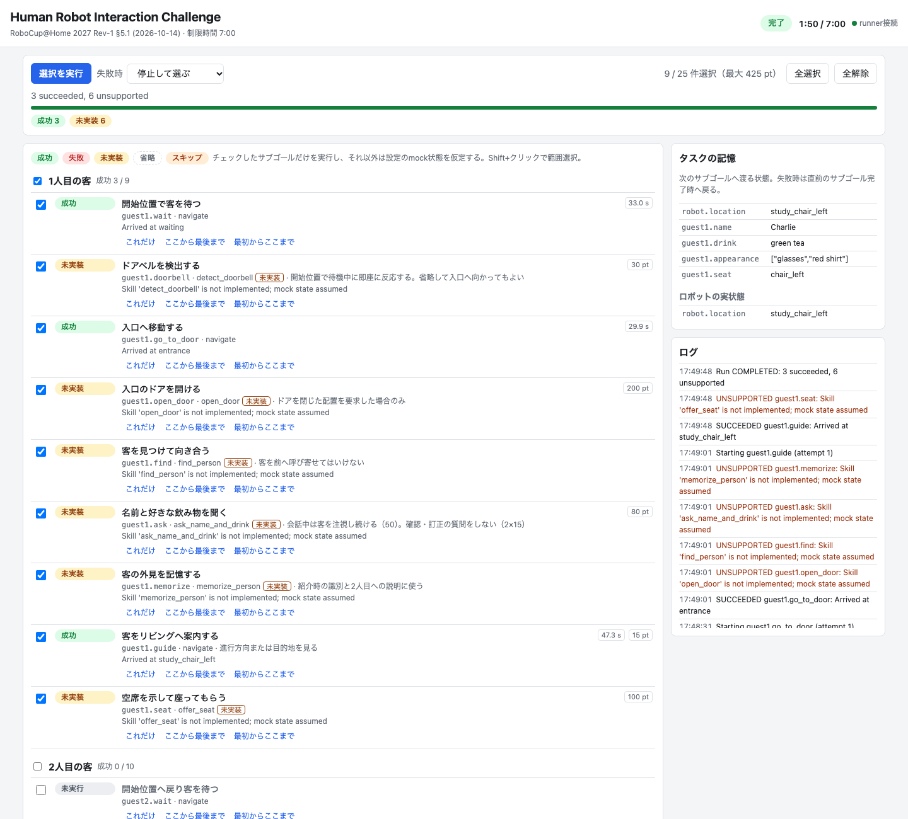

# aha_tasks

タスクをサブゴールに分けて実行・可視化する共通基盤と、RoboCup@Homeのタスク定義。

| 構成 | 内容 |
| --- | --- |
| `aha_tasks/core/` | ROS非依存の実行基盤。タスク定義の検証、サブゴールの選択、チェックポイント・ロールバック |
| `aha_tasks/skills.py` | 組み込みスキル `navigate` と `robot.location` の復元 |
| `aha_tasks/people.py` | 人の認識（[person_perception](../aha_perception/README.md#人の認識)）を使うスキル |
| `task_runner` | タスク定義を実行し、状態を配信・操作を受け付けるnode |
| `task_monitor` | 進捗表示・部分実行・失敗時の操作を行うWeb GUI |
| `config/<task>.json` | タスク定義 |
| `launch/task.launch.py` | RCJO2026のGazebo、固定地図のNav2、runner、GUIを起動 |

ROSの入出力は [ROSインターフェース](../../../docs/interfaces.md#サブゴールタスクの実行)を参照。

## 起動

[開発コンテナ](../../../docs/docker.md)で実行する。別のsim / SLAMと同時に起動しない。

```bash
cd /app/overlay_ws
colcon build --symlink-install --packages-up-to aha_tasks
source install/setup.bash
ros2 launch aha_tasks task.launch.py task:=human_interaction
```

GUIは `http://localhost:8765/`（macOSは [`make forward`](../../../docs/docker.md#2-guiに接続する)）。
Nav2がACTIVEになると待機状態になり、GUIから実行する。runnerが終了するとlaunch全体が終了する。
ロボットの初期位置（Gazeboのspawn、AMCLの初期姿勢）はタスク定義の `initial_state` の `robot.location`。

| 引数 | 既定 | 内容 |
| --- | --- | --- |
| `task` | 必須 | `config/` のタスク名、またはJSONのパス |
| `headless` | `false` | Gazebo GUIを起動しない |
| `gui_port` | `8765` | Web GUIのport |
| `people` | `false` | 頭部カメラのbridge、[person_perception](../aha_perception/README.md#人の認識)（DGX Spark）、`head_look_at.py` を起動 |
| `ssh_host` / `ssh_port` / `ssh_user` | `10.99.0.1` / `2222` / 空 | `people:=true` のDGXの接続先 |
| `subgoals` | 全て | 既定の選択 |
| `on_failure` | `pause` | 失敗時のポリシー |
| `max_retries` | `1` | ポリシー `retry` の再実行回数 |
| `startup_timeout` / `goal_timeout` | `300.0` / `600.0` | Nav2の起動待ちと各移動の上限（実時間の秒） |

## 実行の仕組み

- **部分実行**: 選択外のサブゴールは実行せず、スキルの期待状態と `mock` をタスクの記憶へ適用する。未実装のスキルも同様に通過する。
- **状態の同期**: スキルの実行前に、記憶上の `robot.location` と実際の位置が異なればNav2で移動する。
- **ロールバック**: 失敗するとタスクの記憶とロボットの位置をそのサブゴールの開始前へ戻す。人やドアなどは手で戻す。
- **失敗時のポリシー**: `pause` は停止してGUIで再試行・巻き戻し・スキップ・中断を選ぶ。`retry` は `max_retries` 回まで再実行、`skip` は `mock` を仮定して続行、`abort` は終了する。

経過時間は制限時間と並べて表示するが、採点・時間切れの判定はしない。



## タスク定義

[human_interaction.json](config/human_interaction.json) を参照。未知のキー・地点、不正な値は起動時にエラーになる。

| キー | 内容 |
| --- | --- |
| `task` / `title` / `rulebook` / `time_limit` | 識別子、表示名、ルールの出典、制限時間（秒） |
| `locations` | `map` frameの地点 `[x, y, yaw]`（m、rad） |
| `initial_state` | 開始時のタスクの記憶 |
| `skills` | スキル名と実装 `"module:Class"`。`null` は未実装 |
| `subgoals` | 実行順のサブゴール。`id`、`title`、`group`、`skill`、`params`、`mock`、`points`、`note` |

選択は `,` 区切りで、id（`guest1.ask`）、glob（`guest1.*`）、範囲（`guest1.find..guest1.seat`、片側省略可）を組み合わせる。
ROSなしで定義と選択を確認できる。

```bash
# リポジトリ直下
PYTHONPATH=overlay_ws/src/aha_tasks python3 overlay_ws/src/aha_tasks/scripts/task_runner \
  --config overlay_ws/src/aha_tasks/config/human_interaction.json --dry-run --subgoals 'guest2.*'
```

## スキルの追加

`aha_tasks.core.Skill` を継承し、タスク定義の `skills` に登録する。
インスタンスはスキル名ごとに1つで、`self.runtime` から `node`・`spec`・`navigation` を使える。

```python
from aha_tasks.core import Skill, SkillResult


class AskNameAndDrink(Skill):
    @classmethod
    def validate(cls, params, spec):  # 起動時。不正ならValueError
        ...

    def ready(self):  # 依存するserverを待つ
        ...

    def execute(self, ctx):  # ctx.params / memory / cancelled / log
        guest = ctx.params["guest"]
        return SkillResult(True, "", {f"{guest}.name": name, f"{guest}.drink": drink})
```

成功時の `outputs` はタスクの記憶へ追加され、後続が `ctx.memory` から読む。
`expected(params)` は成功後とmock時に記憶へ追加する状態。ロボットを動かすスキルは `robot.location` を出力する。
`execute` はタスク用threadで呼ばれる。`ctx.cancelled` を監視し、中断時は速やかに戻る。

## Human Robot Interaction Challenge

[ルールブック §5.1](https://robocupathome.github.io/RuleBook/rulebook/master.pdf)（2027 Rev-1、2026-10-14ドラフト）を25サブゴールに分ける。
`points` は得点表の最大点で、実行中に継続して求められる項目（注視など）はそのサブゴールに含める。
実装済みのスキルは `navigate` と、人の認識を使う `find_person` / `memorize_person` / `locate_guests`（`people:=true` が必要）。

客席・ホスト・荷物置き場は固定の代替地点。入口のドアは閉じたままで、ロボットは内側の `entrance` まで移動する。
人・荷物のモデルは配置しない。地点は `/aha/tasks/locations` に配信し、RVizで表示できる。

```bash
rviz2 -d "$(ros2 pkg prefix --share aha_navigation)/rviz/nav.rviz" --ros-args -p use_sim_time:=true
```

### 人の認識を使うスキル

`/aha/perception/people` の人をスキル間でIDと名前で受け渡す。出力の `<役割>.position` は人の体の中心（`<役割>.frame` の座標）。
person_perceptionが起動していない場合は、実行時に失敗する（起動時の待機はしない）。発話は含まない。

| スキル | 動作 | 出力 |
| --- | --- | --- |
| `find_person` | 名前のない人のうち最も近い人を見て、`distance`（既定1.0 m）手前まで近づき向き合う。人が `map` 以外の座標なら見るだけ | `<role>.track` / `.position` / `.frame`、`robot.location` |
| `memorize_person` | `<guest>.track` の人（いなければ名前のない最も近い人）の外見を `guest` の名前で覚え、VLMで特徴を求める | `<guest>.appearance`（英語句のリスト）、`.track` / `.position` / `.frame` |
| `locate_guests` | `guests` の全員が名前付きで見えるまで待つ。名前はVLMが外見で照合して付けるため、席を入れ替えても区別する | 各客の `.track` / `.position` / `.frame` |

待つ時間は `timeout`（`find_person` / `locate_guests` は30 s、`memorize_person` は10 s）、VLMは `describe_timeout`（180 s）で変更できる。
`memorize_person` をmockにした場合は外見を覚えないため、後の `locate_guests` はその客を見分けられない。

